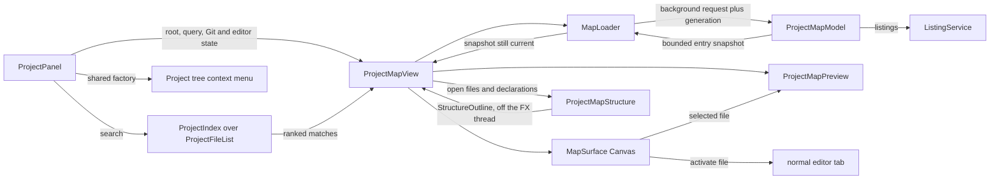

# Project Map canvas navigator

The Project Map is the spatial file navigator of the Project tool window. It complements the
traditional tree; it does not replace the tree or introduce a second file-management model. The Map
always opens in a window of its own (`ProjectMapWindow`), never inside the Project tool window, which
keeps showing the tree: a canvas of columns wants the room of a document, not of a side panel. Both
share the active project root, filesystem watcher, file-opening callback, editor and Git state,
ordering, icons, and context menu actions; each has its own search field.

The focus-traversable **Map** button beside the Project search field opens the window, or brings it
forward when it is open already; the `project.toggleMapView` command (Alt+Shift+1, ⌘⇧1 on macOS, `C-c o m` in Emacs) does the same from
the palette — even with the Project tool window closed — and closes the window when it is the one in use.
`projectMap.revealActiveFile` (Project Map: Reveal Active File; Alt+F1, `C-c o r` in Emacs; also the crosshair
button after the breadcrumb and the ⋯ menu's **Reveal Active File**) opens the window or brings it
forward and selects the active editor file on it; Search Everywhere's **Show in Map** key (Alt+Enter where the
keymap leaves it free, else Shift+Enter or Alt+M; the picker's legend names it) does the same for the highlighted
file row, or a symbol row's file (`ProjectPanel.showInMap`); a Map that opens with nothing but its root selected starts
at the active file too, and the ⋯ menu's default-off **Always select opened file** selects every file the
editor makes active while the window is open. With Project support off both commands say so in the status bar.
The window is *not* owned by the editor window: an owned stage stays above its owner for good, so a file
opened from a large Map would land behind it. Unowned, the two stack like any other windows, and the Map
window closes itself when its editor window hides or the project closes; one closed with its project
reopens when a project is set again in the same session, as at startup. Whether it was open, where, and
whether it was maximized (its bounds then stay the size it restores to) is remembered per workspace, and a
workspace that last had it open reopens it (without taking focus from the editor), with the Project tool
window closed too: the window builds the Project panel at startup for it. The Map lists nothing until its
window is first opened, and reloads every time it opens, so a window that never opens the Map costs no
listing and no loader thread.

In the No Project window the tree's root follows the active tab's folder, but an open Map keeps the folder
it was opened on (`ProjectPanel.setMapRootPinned`): opening a file from it, a tab in another folder, or an
untitled, Welcome or remote tab leaves it as it is. It takes the tree's root again only when it is opened
anew (bringing it forward keeps its folder), or when Reveal Active File needs a file it does not hold. A
remote folder mounted in that window re-roots it as a project would.

The window holds, top to bottom, the search row, the results strip (while a query searches), the Map, and the
Map's own **status line** (`ProjectMapStatusLine`, review 3 A2). Every message the Map has — a folder it cannot
read, the row limit, the search's notices, "no active file" for Reveal Active File — goes to that line, never to
the editor window's status bar; so does the outcome of a move, an undo or a delete while the Map window is the
one in use. A search's notice goes with its query; any other message stays until the next.

Work started in the Map window that happens in the editor window brings the editor window forward:
opening a file (a row, Enter, a preview card's Open), and every context-menu action except Rename, New
Folder, Undo Move, Delete and Reveal, which stay over the Map — the name prompts in the Map window's own
overlay host, the confirmations owned by its stage. A card's Add Personal Note prompts there too, titled
with the file and lines it is for, and the Print Preview and PDF Save dialogs are owned by the Map window.
A folder made with New Folder, and a file made with New ▸ on a Map row (once it opens), are shown and
selected on the Map; Rename to a name that is taken says so, and a case-only rename goes through a
temporary name, for case-insensitive disks. Escape with nothing left to dismiss returns to the
editor, in the editor window. The window mirrors the editor window's stylesheets (an editor-theme switch
reaches an open Map, as it does a floating tool window) and copies its icons, and gets the
editor window's key dispatcher, as a floating tool window does.

The implementation is deliberately hybrid. Native JavaFX controls handle text entry, checkboxes,
buttons, focus, accessibility, and popups. A focusable `Canvas` draws the hierarchy, connectors,
selection state, and overview and performs explicit hit-testing. A separate native overlay provides
the floating code preview.

## User model

The map presents branch-aware Miller columns through the project:

1. The first column contains the root's children and is titled with the root's name. The root has no row
   of its own: that title stands for it. It is selected there (the breadcrumb's first crumb, or the arrow
   against the flow from a first-column row), right-clicking the title opens the root's context menu, and
   the first column has no close button.
2. Expanding a directory shows its children in a new column at the next depth.
3. Expanding a sibling retains the existing branch and opens another independent column.
4. Closing a column or collapsing its parent removes only that branch and its descendant columns.
5. With **Compact folder chains** (options ⋯ menu, on by default; `isCompactChains()` /
   `setCompactChains(boolean)` on the view) a run of single-child folders is one column. Opening a folder
   whose only child is a folder opens that one too (`ProjectMapModel.Request.compactChains`: not through a
   symbolic link, at most `MAX_CHAIN` (32) deep, not for the root's own only child, and never while a
   search decides what is open), and `ProjectMapModel.columnsById` folds the one-row columns into the
   column they lead to: `src` › `main` › `java` › `com` › `acme` is one column of `acme`'s children, titled
   `src / main / java / com / acme` and hanging from the `src` row (`Column.chain()`). A column with a
   filter of its own, or rows a filter or limit took out, is not folded, and neither is the first column.
   Paths and depths stay those of the real folders. The folders of a chain keep their crumbs in the
   breadcrumb; selecting one selects the column's title (which underlines it), the arrows step past the
   chain to the column's rows or back to its first folder's row, and the column's × closes the chain at
   that row. Turning the option off keeps the folders a chain opened open, one column each.

Every column but the first has one meaningful parent row, but several parents may own independent columns
at the same depth. This keeps parallel work visible without merging unrelated subtrees into one dense
column.

The default flow is left to right (`ProjectMapView.DEFAULT_FLOW`), the direction the breadcrumb and
the Tree read in. The ⋯ menu's **Flow** submenu (it left the filter row in the Map explore round, position 17)
also offers right to left, top to bottom, and bottom to top. It
changes column placement, connector direction, and the meaning of the arrow keys together. Changing
flow clears manual column offsets and locks, then auto-fits the new layout. The last selected flow is
stored in workspace state and restored when the editor is reopened. Right-to-left was the default
before workspace schema v13 and was written into every file, so the v26 step resets a stored
right-to-left to left-to-right once (`ConfigMigrations.resetRightToLeftMapFlow`).

## Interaction reference

### Pointer

| Gesture | Result |
| --- | --- |
| Single-click a folder | Select and expand it; if it is already expanded, select it and bring its column into view |
| Click a folder's chevron (the row's trailing edge) | Expand or collapse it; collapsing closes its descendant columns |
| Single-click a file | Open it in a normal editor tab; with the ⋯ menu's default-on **Single-click opens files** off, only select it |
| Double-click a file | Open it (what opens a file while **Single-click opens files** is off) |
| Click a file's preview icon | Open or focus that file's floating read-only preview on the canvas |
| Click a file's Structure icon (just before the eye) | Open or close the file's structure column |
| Click a declaration | Open or focus a floating preview of only its lines |
| Click a declaration's chevron | Open or close the column of the declarations it holds |
| Right-click a node | Select it and open its menu: the Map's own **Preview**, **Show Structure** / **Hide Structure**, **Personal Notes** (when the row has some) and **Close Column** (the column the row is in) first, then the same context menu as the Project tree, including first-line bookmark and Personal Note actions; a file row also has **Related Test / Subject**, and a folder's has **Find in Folder…** (the Find in Files popup set to that folder) and Git ▸ **Show Git History** (the Git log searched for `path:<folder>`) |
| Drag empty canvas space, or a row | Pan the map (from a row, once the pointer has moved 5 px, so a click stays a click) |
| Middle-button drag | Pan the map, wherever the drag starts (including on a row) |
| Mouse wheel | Zoom around the pointer position; scroll inertia does not zoom |
| Shortcut + mouse wheel | Zoom faster around the pointer position |
| Horizontal scroll (touchpad swipe, tilt wheel) | Pan horizontally |
| Pinch | Zoom around the gesture |
| Shift + mouse wheel | Pan horizontally |
| Alt + mouse wheel | Pan vertically |
| Drag a column header | Move that column independently unless it is locked; it stops at its parent column |
| Click a column lock | Prevent or allow accidental header dragging. The lock shows only while its column is hovered, one of its controls has the keyboard, or it is locked (`MapSurface.canvasLockShown`; it keeps its place, so nothing moves when it appears) |
| Click a column close button | Close that branch and all of its descendant columns |
| Row menu → **Close Other Branches** | Close every column, folder or Structure, that is not on the way to that row; a folder row keeps its own column. Offered while such a column is open |
| Options (⋯) menu → **Collapse All** | Close every column but the first and the ones on the way to the selection (`ProjectMapView.canvasCloseOthers`, `MapLoader.canvasCloseOthers`); cards opened from the closed columns close with them. "Nothing to collapse" when only those are open |
| Options (⋯) menu → **Open cards** | List the open cards, the most recently used first; one brings its card into the middle of the map area with the keyboard in it |
| Options (⋯) menu → **Print…** | Open the standard print preview for the complete map layout, the open cards where they stand |
| Options (⋯) menu → **PDF…** | Export the complete map layout and the open cards using the configured PDF page size; the map's names are searchable text |
| Options (⋯) menu → **Export ▸ PNG…** | Save the map as it is on screen at 2× (cards and connectors, not the zoom bar, overview or notices), at most 8,192 px a side |
| Options (⋯) menu → **Export ▸ SVG…** | Save the whole map as Print/PDF lays it out (without the cards), every row name and column title as SVG text |
| Editor tab menu / Project tree menu → **Reveal in Map** | Open the Map window (or bring it forward) and select that file or folder, beside Reveal in File Manager |
| Click **?** | Show what the Map is for and its pointer, cards and notes, keyboard, search ("where am I" included: Reveal Active File, Always select opened file, Project overview) and filter models in a popover (key names in the user's language, modifiers as the platform writes them) |
| Click or drag in the overview | Centre the view on that point of the map, clamped to the map's bounds; a press on a card's mark brings that card into view |

Preview and note cards, and what is stuck on a card, belong to `MapCards` (review 3, stage 1 of the refactor
plan): their lifecycle, use and eviction, placement, connectors, refresh and poll. It reaches the map through
`MapCards.Host`, which `ProjectMapView` implements over its surface; sticky notes and a card's Structure column are
`CardAttachment`s, treated alike for raising, focus, placement, connectors and closing. Cards sit on the canvas: a
pan or zoom carries each card's corner with the map under it and draws the card at the map's zoom from that corner
(`MapSurface.moveCardsWithViewport` → `MapCards.moveWithViewport`, run after every paint, sets each card's
`setMapScale`), so cards shrink and grow with the columns. A card's own width and height are unzoomed;
placement, overlap, connectors and size limits work on the card as drawn (`MapCards.cardScale`), and the resize
grip divides the pointer's movement by the zoom. Each title bar
moves its card — like a column header, anywhere, including out of view, where panning finds it again — each
lower corner resizes it up to the panel's size at the current zoom, and each editor scrolls independently.
A resized panel bounds a card's size but never moves it; a zoom never resizes a card, so one zoomed in may
outgrow the panel as a column does. The map area (`canvasHost`) clips its children, so whatever part of a card
lies outside it is neither drawn nor clickable — never over the filter bar or breadcrumbs above. The card's own − / + buttons scale its text on top of the map's zoom. Opening another file
keeps existing cards visible; clicking an already-previewed file focuses its existing card, and each
close button removes only that card. An accent connector runs from every preview to its source file row
and follows map pan/zoom plus card movement and resizing. A move only marks the connectors; they are drawn once,
at the map area's layout pass (after the surface and the cards are laid out) or the next pulse, whichever comes
first (`MapCards.connectorsMoved`), however many cards and attachments moved. A card's title keeps room for its
file's name (a declaration card's file and declaration name up to its parameters), up to half the card; the status
line gives way first and is read in full from its tooltip, read-only is a muted lock, and the buttons never shrink.
A whole-file card opens past a leading licence header — a comment block of three or more lines that names a
copyright or licence, after an optional `#!` or `<?xml` line — on the next non-blank line, the caret there and the
numbers the file's own (`ProjectMapPreview.openingLine`).

Open cards stay in map space, so navigating elsewhere takes them out of sight; the overview marks every card in
sight (note cards in the note colour), and counts the cards in its picture, so a card out of view brings it up. A
press on a mark, or the card's item in the options menu's **Open cards**, pans the map until the card stands in the
middle of the map area and puts the keyboard in it (`MapCards.bringIntoView`).

Code previews and note cards are placed by one path (`MapCards.previewPlacement` over
`MapSurface.cardSite`): the spot that covers least. The candidates are after and before the row's column,
above and below the columns' band, and every corner of free panel the card fits against (at full size, or as
large as fits down to its minimum); each is scored by what it would cover on screen
(`MapCards.cardOverlapCost`) — the row's own column weighs 6, the columns that lead to it 4, the band where
the row's next column (a folder's, or a file's Structure column) would open 3, other columns 1, other open cards
and what is stuck on them 5, and the zoom bar and the overview 60 (`MapCards.CHROME_WEIGHT`, for every row, also
beside a card's Structure column and for a row off the map) — then by nearness to the row and by size (narrower than
its lines weighs more than shorter). Each spot is also tried cut short of the zoom bar and the overview, down to the
card's minimum, so a new card does not open with its last lines under them. Each spot also weighs where it stands
against the way the map flows (`MapCards.cardFlowCost`, Map card flow): nothing past the row's column the way the map
flows (right of it left to right, left of it right to left, below it top to bottom, above it bottom to top), a
quarter of the card's area beside it, half behind it, over the columns that lead to the row — and as much for any
spot that covers the row's column or those columns, so the flow never buys covering the path to the row; and spots
level with the
row are tried past whatever stands on the flow side (the band the row's next column would open in, a column already
open there). A declaration card opened from a file card's Structure column opens right of the file card (Map
Structure right): past the column, which always stands on the card's right, level with its row; with no room there the
file card, with its column, first steps left until the card's minimum fits (`MapCards.cardStructureRoom`), as far as
the panel's left edge allows, and of the spots left the best one right of the file card wins over any other. Linked result cards go around the card they were found from and
weigh no flow. **With "Focus new column" on (the default) a new card opens as a new column does**
(`MapCards.openingPlacement`, `cardColumnSpot`, `cardCentringPan`): a code or note card whose row is on the map goes
past the row's column the way the map flows, `CARD_COLUMN_GAP` (40) from it, centred on the row across the flow or,
when long, hanging from it (at most `CARD_COLUMN_LEAD`, 150, before it), and on past any column or card already
standing there; the map then pans so the card stands in the middle of the map area (its top-left corner, when it is
larger), shifted only as far as it takes to keep its row in sight when both fit. Result cards, declaration cards from
a file card's Structure column, rows off the map, Move to Free Space and cards placed again keep the free-room
placement above. **With the option off, placement never pans the map**: with no room past the row's column the way
the map flows, the card takes the side of the column — beside it across the flow (above or below it left to right or right to left, left
or right of it down or up the panel), cut to the room there down to its minimum, and slid along the row as far as it
stays level with it to clear the zoom bar, the overview and other cards. A card left of its column widens leftwards
when its text arrives, in every flow, rather than back over the column. A card is never smaller
than its minimum (340 × 220 for code, 300 × 180 for notes) unless the panel itself is. Text that arrives
after a card was placed only widens it where it stands, by at most 120 columns and never past the panel
(a card already partly out of view is never narrowed);
a card the user moved keeps its position and one the user resized keeps its size.

Up to eight cards remain open, code and note cards together; a ninth replaces the least recently used
one that is not pinned. A code card's **pin** (in its title bar, and **Pin Card** / **Unpin Card** in its menu)
means keep (Map review 4, position 3): a pinned card survives every automatic close — eviction, its folder's
column closing, Collapse All and Close Other Branches, the orphan check, Escape on the map, a trail leaving its stop,
the card it was found from closing, and a declaration card stepping onto its declaration (the keyboard goes to the
pinned card instead, and the stepping card closes unless pinned too); only its own × (or Escape in it) closes it,
and a root change or a working set closes everything. When every card that could go is pinned, a new card is refused and the
Map's status line says "All 8 cards are pinned: unpin one to open another" (`MapCards.makeRoomForCard` answers
false; `roomForCard()` is the same check for a caller that builds its own cards). Pressing a card, moving keyboard focus into it and scrolling it all count as use, and so does any use of what
is stuck on it — focus or a key in its Structure column, focus in a sticky note. Eviction works on groups: a file
card with its Structure column out keeps the declaration cards of its file, goes only after them (the oldest of
them first), and never while one of its declarations is being opened (`MapCards.makeRoomForCard`), so reading a
file's declarations from its column by keyboard never closes the file card, its column and every card read so far. A folder's cards
close when the folder stops being expanded, however it was collapsed (but not a pinned card, nor a linked result
card while the card it was found from is open: `MapCards.closeUnder` and the orphan check both keep them), and all
cards close when the root changes. Closing the Map window and opening it again keeps them where they were.

A preview uses current unsaved text when the file is already open; otherwise it reads the file off
the JavaFX application thread, decoded as the editor would open it (BOM, then the `.editorconfig`
charset, then UTF-8 with a single-byte fallback instead of U+FFFD) and with `\n` line endings. It is
visibly marked read-only, has independent text/image zoom controls, and renders common bitmap image
formats as well as syntax-highlighted text. Its lock says what a card is for: "Preview — read only; Open to edit"
(tooltip and accessible text), and the ? popover's Cards section opens with one sentence: cards are for a glance
beside the map, the editor for reading and editing. Card text is set in the editor's font family and size
(published on the editor window with the console and Diff fonts, `ProjectMapPreview.EDITOR_FONT_KEY`, and
followed by that window's Map), and a new card opens at the −/+ text
zoom last used on a card of the same Map. A file over the 160,000-character highlighting cap has its first
lines coloured, and the status says how many. A binary file (a NUL in its first 8 KiB) or an image over the
20 MB decode cap gets a compact card of facts instead — size, type, modification time, an "Image too large to
preview (N MB)" heading for the image, **Reveal in File Manager** — with **Open** disabled. Its context menu can
copy the selection (**Copy All** with nothing selected), select all, add a
bookmark at the clicked line, add a Personal Note for the selected or clicked lines, or **Move to Free Space**
(the card is placed again, at its size, as a new card would be); opened from the
keyboard (Menu key, `Shift-F10`) it opens at the caret and acts on the caret's line. The **Open**
action promotes the previewed file to a normal editor tab. A file card cut at the display cap says how much of the
file it holds ("Showing lines 1–7,515 of 9,135", or "Showing the first N lines" when the rest is not counted: past
64 MB on disk, or an open buffer past 4,000,000 characters) and ends in a last line, "— Preview ends here; Open to
read the rest —", which opens the file when clicked.

**Find in a card.** Find typed in a focused card (`find.show`: Ctrl+F, Cmd+F, Emacs `C-s`), or the menu's **Find in
Card…**, opens a find bar under its title bar: a field (a one-line selection is what it looks for), "k of N", ‹ ›
and **Aa** (match case). Typing selects the first match from where the find began; Enter and Shift+Enter, F3 and
Shift+F3 (the field claims `f3` / `S-f3` through `KeyDispatcher.CLAIMED_KEYS`, so they step whatever the keymap
binds them to — Emacs F3 records a macro elsewhere; review 4, C10), `find.next` / `find.previous`, and `C-s` / `C-r`
again in the field step through the matches, wrapping.
It searches the text the card shows (a declaration card's lines), at most 10,000 matches counted. Escape closes the
bar first and leaves the match selected; the next Escape closes the card. The find commands go through
`KeyDispatcher.HANDLED_COMMANDS`, so they follow the keymap and never reach the editor's own find.

**Title bar.** Title, lock, status, then a declaration card's ‹ ›, −/+, the pin, Structure (file cards), Notes,
Open and ×. The title keeps room for the file's name (a declaration card's: up to its parameters), at most half
the card (review 3, C11), and takes whatever the buttons leave up to its whole text before the status gets any;
the status gives way first and is read in full from its tooltip. When even an empty status leaves too little room,
optional buttons go in turn (`fitTitleBar`): −/+ (also when they would leave the status under 140 px), the pin
unless pressed, ‹ ›, then Notes unless pressed. The menu has each of them.

**Git context.** A card's status ends with "Last change: <author>, <relative date>" — a file card's file's last
commit (`git log -1 -- <file>`), a declaration card's lines' (`git log -1 -L<start>,<end>:<file>`, given 2 s, else the
file's) — with the subject and short hash in the status's tooltip, saying whether it is the lines' or the file's
change. `GitService.lastChange` runs on the Git service's history lane, never on the FX thread, and caches each
answer by HEAD, file and lines; HEAD is read at most every 3 s per folder, so a commit or checkout is followed on the
next card refresh. The lines are the file's on disk: when it has uncommitted edits they are mapped to HEAD's lines
through `git diff -U0 HEAD` first (`GitService.diffHunks`/`headLine`), and lines that are all new give the file's last
change. In a shallow clone an answer that is a boundary commit (listed in `.git/shallow`) is flagged `shallow` and the
status reads "Last change: before this shallow clone's history" instead of naming the clone's commit (Map review 4,
C7, C8). Asked when a card opens, steps, follows a rename, and on every card refresh that is not the
once-a-second poll; nothing outside a repository, with Git off (`ProjectTreeFileActions.gitLastChange`), or for an
uncommitted file. The card menu adds **Annotate** (the editor's blame of the file, at a declaration card's
declaration) beside **Show Git History**.

An open preview is kept current without being moved or re-scrolled: a card that mirrors an open buffer
looks for edits once a second while the Map is on screen and replaces only the range that changed (a buffer
whose edit counter, `Content.version`, did not move is not even read, and one read serves the file's cards and
outline), and its status says "Unsaved changes" while the buffer has them; any
other card re-reads its file when the Project watcher reports a change and the file's size or
modification time differs. A card follows an in-app rename or move of its file (or of a folder above it):
`pathRenamed` re-keys preview and note cards to the new path and the card reads the file there. A card
whose file was deleted, or renamed outside Editora, keeps its last text, says the file no longer exists,
and disables **Open**.

`Escape` in a focused card closes it and returns focus to the map; `Tab` leaves the preview's text, and a `Tab`
past the card's last control comes back to the map instead of wrapping to the search field. Closing a card that
holds the keyboard — its ×, Shift+Enter, or a sticky note's card — also hands the keyboard back to the map.
Global chords still act on the active editor tab while a card has focus (the app-wide key policy), except
the note and bookmark commands (`notes.add`, `notes.editNote`, `bookmarks.toggle`: `C-c n`, `C-c m` in Emacs),
which a focused card runs on its own file (`KeyDispatcher.HANDLED_COMMANDS`, keyed by command so it follows the
keymap): a note on the selection or the caret's line, a bookmark on the caret's line, and Edit Note brings the
card's notes up. So a focused card has an accent border and its text area's accessible name states the file and
that it is read-only. Alt+arrows move a focused card, note card or sticky sheet by 16 px and Alt+Shift+arrows
resize a card (`ProjectMapPreview.GEOMETRY_KEYS`, claimed through `KeyDispatcher.CLAIMED_KEYS`); the new place and
size go in its accessible help. The Structure tool window's command (`tool.structure`: Alt+7 in the Emacs and
IntelliJ keymaps) typed in a file card shows the card's own Structure column and puts the keyboard there; typed in
the column it goes back to the card; the card menu's **Show / Hide this preview's Structure** does the same.
A card follows the code (`ProjectMapPreview.FOLLOW_COMMANDS`): Go to Definition, Find Usages, Go to
Implementation, Type Hierarchy and Call Hierarchy typed in a card (F12 / Shift+F12 in the CUA and VS Code keymaps)
or picked from its menu open the card's file in the editor at the card's caret (the menu's: where it was
right-clicked) and run the command there (`FileActions.followCode` → `FileWorkflowCoordinator.openThenRun`), and the
editor window comes forward; Go to Related File typed in a card, and the menu's **Related Test / Subject**, reveal
the file's test or subject on the Map (`search.RelatedFiles` names, looked up beside it and in the Map's file list;
several are offered in a menu under the breadcrumb), and Show Git History typed in a card, or its menu's item, is
the card's file's. A declaration row's menu has the same items at the declaration, with the caret on its name.

**Linked reference cards** (explore position 5, `MapCardLinks`, `ProjectMapLinkSearch`). A code card's menu and a
declaration row's menu (the Map's Structure columns and a card's) have **Show References as Cards** and **Show
Callers as Cards**. A declaration card (or row, whose card opens first) asks about its declaration, its name found on
its line; a file card asks about the name under the menu's place. The answer:

- **From a language server** when one already runs for the file's language in this window, at the deepest session
  root that holds it (`LspManager.runsFor`). The file is *lent* to that session (`LspManager.lendDocument`: a
  `didOpen` under an opener of its own, so an editor tab opening or closing the file meanwhile keeps its own hold,
  and `didClose` only when nothing holds it) for `textDocument/references` (usages only, as Find Usages asks) or
  `prepareCallHierarchy` + `callHierarchy/incomingCalls`, and given back with the answer. No editor tab is opened,
  the editor window is not raised, and nothing starts a server.
- **By name** otherwise, and when the server does not answer that request: the name as a whole word in the
  project's files of the same language (the Map's `ProjectIndex` list), for callers only where `(` follows; at most
  20,000 files, 1 MB each, 2,000 places, 2 s (then the status line says it stopped early). The declaration itself,
  and other declarations of that name (by the outline), are left out. The status line says no server answered.
  The files nearest the asked file are read first — its own folder, then its module's, then the rest, code before
  tests unless it is a test itself (`ProjectMapLinkSearch.linksScanOrder`) — so a popular name's capped answer is
  the code around the declaration (review 4, C9). A server that fails or times out (`prepareCallHierarchy`,
  `incomingCalls`, `references` with an error callback) is not taken as "nothing there": the name is matched, and
  the status says "The language server did not answer (…), so the name was matched." (C6). Until a file card's name
  is known the status says "Finding callers…" (C12).

The places are grouped by the innermost declaration of their file's outline whose own lines hold them, searched
over the whole outline — a Go method is listed under its type, whose lines are only the struct's (review 4, C1) —
(the outlines of the first 12 files are read, waiting at most 4 s; places past them, or outside every declaration,
group by file). The groups are ranked (`MapCardLinks.linksRank`): code before tests (unless asked from a test),
then nearest the asked file's folder, then path and line order. The first six groups open as declaration cards (a
file group: a file card) scrolled to the place, the name there selected as find selects a match — the call itself
in a caller, found from the caller's first line (`ProjectMapPreview.linksRevealPlace`, review 4 C2) — **beside the card asked from** (`MapCards.drawnPlacement` takes that card as the row), at most 460 px wide
and kept at that width. **Each result card gets a place of its own**: besides the free-room spots, it is tried beside
the card asked from at every level that keeps it level with that card, and above or below it anywhere along it, past
the result cards already opened (`cardSideLevels`), so the cards of one answer stack around it instead of over it or
each other; only when the panel has no such room left does the last one take the spot that covers least. "Focus new
column" never applies to them: `columnRulePlacement` only checks `MapCardLinks.placesBeside`, leaving the card's place
beside its source for `besideSource` to take when it is placed. Each is joined to it by an **edge**: a line from the result card to the card asked from with an
arrow at that end, and a label at its middle — "calls", "references", or "by name" (the line dashed), with "· N"
for more than one place. The rest are listed by a **"+N more"** chip on the card's top edge (under the card when
there is no room above it); picking one opens its card with its edge. The chip is kept above every card: it is
raised once the result cards open and whenever any card rises (`MapCardLinks.linksRaiseChips`, C3), and the status
says "N more listed by the card's “+N more” button". While an answer opens its cards, the card it was asked from
and its other result cards are never the ones evicted for it; a place that finds no room (the other cards pinned)
goes on the chip with every later one, and the status adds "No room for more cards: the others are pinned or show
this answer." (C4). The edges of one question are an `MapCardLinks.EdgeSet`, a `CardAttachment` of the card asked
from: drawn with the other connectors once per pulse, closed with that card; a result card closed or evicted takes
its edge away. Labels sit just above the connector canvas, under every card. Each result card's accessible name
and title tooltip end with what joins it ("total(App) calls App.java › add(int) (2 call sites)"), cleared when the
edge goes; the chip's accessible text names what it lists. Asking the same card the same question again replaces
its edges (the cards stay); a result card is never closed by the orphan check while the card it was found from is
open. The result cards an answer opened (not cards that were open before it) **close with the card they were found
from** — closed, evicted or closed with its column — unless pinned or still another open answer's (review 4,
position 4 / C11). A declaration card that steps (‹ ›) ends its own questions: their edges go and the result cards
they opened close, and an answer still pending is dropped; a result card that steps loses its edge and link text but
stays its answer's card (`MapCardLinks.cardChanged`, C5). Cards share two `project-map-preview-loader` threads that time out when idle, each
card's reads still in order; a card created before its host has a size waits for the size, not on `runLater`.

Context menus use JavaFX auto-hide plus a next-pulse owner-scene press filter. This mirrors the
other Project menus and ensures a click elsewhere closes the menu even on platforms where the
native popup grab misses the press.

Files and folders with one or more bookmarks or Personal Notes show compact, independently colored
indicators in both the Tree and Map. Personal Notes indicators are interactive, and a file's notes are shown one
way (explore round, position 11): a file row's badge, and its menu's **Personal Notes**, open the file's code card
with its sticky notes out (`MapCards.openNotes`, below); a folder row's open the folder's editable note card,
attached to its row by a connector. The note card of a file remains only as the list a code card's "+K more notes"
sheet opens. A note card and the code preview of the same file open and close independently, under the shared
limit above. The options
menu's default-off “Hide all open Personal Notes” item temporarily hides those cards without closing them.
A note card saves an edit on focus loss, Shortcut+Enter or close, comparing against the body the store
last held. Its text areas, and a sticky sheet's, take the configured keymap's caret moves and basic edits
(`TextInputKeymap.installShared`: `C-f`, `C-b`, `C-n`, `C-p`, `C-a`, `C-e`, `M-f`, `M-b`, `C-k`… in the Emacs
keymap), as the Notes box in the editor does. A note card follows the store: when notes change elsewhere it adopts the new bodies (an edit in
progress is kept), and it closes when its notes are deleted. A blanked note is not a deletion — its text
is restored and the status bar says so. Each note in it is headed, as its sticky sheet is, by its line or lines
(the noted text as the tooltip); pressing the heading opens the file at the note. A folder's note has none.
A note card is styled from the theme's warning (amber) tokens, so it is a pale sheet on light themes and a
dark amber one on dark themes.

A code or declaration card carries its own Personal Notes. Selecting text in it brings up a floating bar over
the selection — the Markdown buffer's (`MarkdownFormatBar.placeY`/`trackMouse`), with one **Add Personal Note**
button — that is gone mid-drag, for a blank selection, with Personal Notes off, on focus loss and on a first
Escape (a second closes the card). A **Notes** button before **Open** counts the notes on what the card shows —
its file's, without folder notes, or those starting on a declaration's lines (`ProjectMapStickyNotes.notesFor`,
all of them) — is disabled at none and absent with Personal Notes off; while "Hide all open Personal Notes" is on it
does not look pressed, says why, and a press turns that option off. A stored note is first found again in the
card's text as an editor tab finds it (`ProjectMapStickyNotes.reanchored`, `NoteAnchors.relocate`), so a file
changed outside Editora does not mark the wrong line; one whose text is gone is headed "Text not found in the file"
and not marked. It sticks them on the card as **sticky
notes** (`ProjectMapStickyNotes`): one small editable amber sheet per note, headed by its line and a × that
closes that one note on the card (`closeNote`: it stays in the store and comes back when the card's notes are shown
again; closing the last turns the Notes button off), each tied by a
note-coloured connector from a dot on the card's edge at its line (the text's top or bottom when scrolled past)
to the sheet. While the sheets are in sight, each note's text in the card is marked as an editor tab marks it —
the editor's `NoteHighlightOverlay` over the card's text, an amber wash with a marker at the note's start, the whole
line for a line note (`ProjectMapPreview.noteSpans`). The sheets stand outside the card's right edge, else its left, else on the card against its right
edge (`side`, by the room the whole stack needs), each as near its line as the sheets above allow, a further
column when they run past the card's foot (`stack`). Notes past what two such stacks hold (`sheetsShown`, at
most 24 sheets) go into one "+K more notes" sheet that opens the file's note card. They hold their place relative to the card's edge as it moves, resizes and zooms; one the user
drags keeps its new spot until the card closes. They save like a note card (focus loss, Shortcut+Enter, a blanked
note restored), follow the store, follow "Hide all open Personal Notes", rise with their card, and close with it;
they are not cards and take nothing from the eight-card limit. A note added from a card — its bar or its menu —
brings the card's notes up once the store has it.
Marker state is read from an open buffer when available and otherwise from
the active project's persisted stores, so adding an annotation refreshes both views without opening
the target file.

### Structure columns and declaration cards

A file whose language the Structure tool window can outline has a **Structure icon** — that window's glyph
of stepped lines — before its eye. `StructureOutline.supports` decides by the name alone (a language with a
bundled grammar, or Markdown, Typst, `.http` or Clojure; never an encrypted file), so a row costs no read.
The icon opens a **structure column**: the file's declarations, as the Structure window shows them, in the
order they are written — one-line members included in every language (`StructureOutline.addFoldlessSymbols`,
not a member call such as `x.run()`), a stylesheet's rules by selector or at-rule, a YAML file's keys read from
its lines (`yamlKeyNodes`, so `on:` is a key, not a boolean; a key whose value goes on below it — a block scalar,
a list, even one at the key's own indent — spans that block). Some languages are read from their lines rather
than from the grammar's symbols: Go (`GoOutline`, as gopls lists a file: functions; methods labelled by their
receiver, `(*Kubelet).Run`, and listed under their type when the file declares it; types with their struct fields
— embedded ones by their type — or interface methods; `const` and `var` names, a typed constant under its type;
never the package clause), Java fields (`JavaFields`, `[modifiers] Type name =|;` lines at a class's member depth,
which the grammar marks nothing on), a Dockerfile's build stages (one row per `FROM … [AS name]`) and a Makefile's
targets with their recipes, a target defined in several `ifeq` branches labelled by line (`all (line 93)`). A class
header wrapped before its brace (`extends …` / `implements … {`, Kotlin's `: Base {` under a wrapped constructor)
takes its name from the line above (`StructureOutline.wrappedHeaderLine`); Kotlin annotations and shell `$…`
expansions are not declarations; a `*.gradle.kts` script is outlined by its blocks' headers (`plugins {`,
`tasks.register("hello") {`), as a Groovy build is. A callable is labelled with its parameter list:
the outline's detail, else the parameter types read from its declaration line (`add(int, int)`; names where the
language writes no types; `(…)` in Go, which has no overloads), else the bare name — never an invented `()`. A declaration that holds others (a class's members, a heading's subsections) ends in
a chevron and opens a further column, as a folder does; a file whose outline is one top-level declaration
with members (most Java files) opens that declaration's column too. The icon sits in a filled disc while its
column is open. A structure column has the usual title (`App.java · Structure`, or the declaration's
label), count, filter, lock and close button, but no Show hidden checkbox. While its file is being outlined,
when it cannot be read and when it has no declarations it holds one explanatory row; past 1,000 rows it ends
in one that says how many were left out, and for a file past the outline's 4,000,000-byte read in one that says
only its start was outlined.

**Clicking a declaration opens a declaration card**: the ordinary preview card showing only the declaration's
lines — its block, from its declaration (or its fold region's first line, when that is above it) to the
region's last line, extended upwards over the doc comment, annotations, decorators and Rust attributes
directly above it (`ProjectMapStructure.range` / `leadingDocStart`) — and the language's own line comments
(`#` in Python, shell, YAML; not `#!`). A heading, and a `.http` request (its headers and body), runs to the line
before the next one at its level; a declaration with no block of its own is its own line, unless the read cap cut
the block it opens off, when it runs to the next declaration or the end of what was read. The card reads and
highlights the whole file and shows that slice — read up to the outline's 4,000,000 bytes, not the whole-file
card's display cap, so a declaration past that cap opens with its own lines — so a line inside a comment or a string is coloured as in the
editor; its gutter keeps the file's numbers in the narrowed amber, its title reads `App.java › add(int, int)`, its
status line says `Lines 9–19 of 29`, and it opens no taller than its lines need (but no smaller than the card
minimum). **Open**, and **Open Narrowed** (the card's and the row's menu), open the file narrowed to the
declaration's fold block (a card whose declaration is gone from the file opens it at its last line instead) through `EditingCoordinator.narrowToFoldRegionAt`, as the Structure
window's Narrow to fold region does. Bookmarks and Personal Notes added from a declaration card land on the
file's own lines. Declaration cards are keyed by the declaration's row, so several of one file can be open,
under the shared eight-card limit.

A declaration row's path is made up: its file followed by one segment per declaration down to it
(`App.java/…sApp~0/…sadd_int__int_~0`), each the declaration's label with its parameter types, made file-name
safe (at most 60 characters), and its place among siblings of the same label. No such path can exist on disk — a
file has no children — and because the segment is a label rather than a line, an open column, the selection and an
open card survive an edit that moves the declaration, and inserting an overload leaves the others' paths alone.
When an edit changes a declaration's parameter list, its open column and card follow it to the new path: the
same-named declaration that is new among its siblings, nearest its old line (`ProjectMapStructure.successor`). `ProjectMapModel.Entry.symbol` rows are neither files nor folders (`isSymbol()`,
`isFile()`): the Project context menu, F2, Delete, the type filter, the open/unsaved/Git/marker states and the
hidden-files filter never apply to them; their emphasis under a filter is their file's. Closing a structure
column, collapsing the folder above its file or deleting the file closes the columns below it and their cards.

`ProjectMapStructure` holds which files and declarations have a column open and the outline of each. Outlines
are built on one daemon `project-map-outline` thread from the open buffer's text when the file is open —
unsaved edits included, and the language server's document symbols when the Structure window has them for
that buffer (`StructurePanel.serverSymbolsFor`) — or from the file decoded as a preview card decodes it but read
up to 4,000,000 bytes and not cut at the card's display cap (`ProjectMapPreview.readOutlineText`), so a file such
as k8s's 480 KB `core/v1/types.go` is outlined whole. Each result is checked against the newest
request for its file. They are brought up to date with the cards: an open buffer is compared by its text
(once a second while one is on show; a buffer past 200,000 characters that already has an outline is outlined
again only once its text has not changed for 900 ms, so its rebuilds do not queue every other outline behind
them), a closed file by its size and time on disk after every listing and
watcher notification. The first listing of a root warms the grammar of the project's main language on the
outline thread (the one a root build file names — `go.mod`, `pom.xml`, `Cargo.toml`, … — else the commonest
outlined extension), so the first Structure column does not wait for it. When an outline changes, every declaration card is moved to its declaration's new lines
(`setRange`); a card whose declaration is gone keeps its last lines and says "No longer in this file", with
its bookmark and note actions off. Text that arrives before the outline is not cut by the old lines: the card
follows its declaration line when lines were added or removed above it, and otherwise holds the new text,
still showing the old lines, until the outline says where the declaration went. No language server is started
for a closed file; a declaration card the workspace brought back (below) waits for its file's outline.

**Outlines of files with no tab from a running server** (explore round, position 10). When a server for a closed
file's language already runs in this window, on a root that holds the file, past its handshake and with document
symbols (`LspManager.outlinesClosedFile`), the file is read as above and lent to that session for one
`documentSymbol` request (`LspManager.closedFileSymbols` over `lendDocument`, the loan the linked cards use too),
the loan ending when the answer is in; a file some window has open is asked about as it is, so its unsaved text is
never replaced, and a tab opened meanwhile keeps it open. The server's outline replaces the
heuristic one; the heuristic one is shown if the server has not answered within 1.5 s (and replaced when it does),
answers with nothing, fails, or takes over 8 s. A file past 1,000,000 characters or cut at the read cap is outlined
by the heuristic only. The server is asked again only when the file changed on disk (or once, when a server starts
after the file was first outlined). The wiring is `ProjectPanel.shareIndexes` → `ProjectMapStructure.ClosedFileSymbols`.

**Declaration cards step.** A declaration card's ‹ › (and Alt+Page Up / Alt+Page Down, claimed through
`DECLARATION_CARD_KEYS`, and the menu's **Previous / Next Declaration**) show the previous or next declaration of the
same file, depth-first through its outline (`MapCards.cardsStep`), in the same card where it stands: the card is
re-keyed to that declaration, its title, lines and gutter follow, its notes and Git context are read again, and
another card already open on that declaration closes. The menu's **Show in Structure** selects its row in the file's
Structure column: the file card's column when that card has it out, else the Map's own Structure column of the file
(opened, with the columns of the declarations that hold it, and the row revealed — `Host.showInStructure`), else
the file card's, which is opened for it.
A file card whose file can be outlined has a **Structure** button in its title bar, before Notes. It sticks a
**Structure column** beside the card (`ProjectMapCardStructure`): the same outline as the Map's Structure column,
as an indented list in the same violet tint, with a lone top-level type opened. Each label is coloured as the
card colours its declaration line (`StructurePanel.labelRuns` over the card's own `CodeArea`, again whenever the
card's text or colours change), and the column is as wide as its longest row needs, between 200 and 360 px, counting only the rows it shows (it refits as a row opens or closes)
(`ProjectMapCardStructure.fit`, measured in the rows' font). It works wherever the file's row
is — filtered, scrolled off or in a closed column — because it belongs to the card: it moves, resizes, zooms,
hides, rises and closes with it, and does not count against the open-card limit. It always goes on the card's
right (Map Structure right), so the declarations read on from the card, and the card's sticky notes stand past it
(`ProjectMapStickyNotes.setReserved`). It stays there when its card is dragged or the map panned, even when that
takes it past the map area's edge. Opened on a card near the right edge, the card first steps left until the column
fits inside the map area; when the column would still cover much — the map's columns (its row's own and those
leading to it heaviest), the zoom bar and the overview, other cards and their attachments — the card moves where card
and column together cover less, if there is such a spot (`MapCards.nudgeForColumn`). A click or Enter on a declaration
opens the declaration's own card beside the column, as a row of the Map's Structure column does (Map Structure
previews); Shift+click or Shift+Enter scrolls the card to it instead and marks its lines
(`ProjectMapPreview.revealRange`), as an outline beside a code view moves the view; the right-click / Menu-key menu
is the row's (Preview — here opening the card beside this column —, Open at Declaration, Open Narrowed); the
Structure window's Emacs moves (`C-n`, `C-p`, `C-f`, `C-b`) work in it; Escape or its × takes it off.

A declaration card follows the Structure column it was last asked for from (`MapCards.cardColumnCards`, by card).
One opened from a file card's column is placed beside that column, by the declaration's row in it, with a connector
from that row (while it is scrolled into sight; else from its Map row, if any), and goes with the column: taking the
column off, or closing the file's own row, closes it, as closing the Map's column closes its rows' cards. One opened
from the Map's own Structure column (a row's click or Enter, a search landing) is placed beside that column with a
connector from its row; it falls back to the file card's column — placement, connector and the orphan check's
keeping — only while its row is not on the map. Asked for from the other column, an open card moves there
(`MapCards.cardFollowColumn`, `ProjectMapPreview.placeAgain`: placed afresh at its size, as a new card), unless it is
pinned, when only its connector moves. A card restored from the last session, a trail stop's or a linked result's
keeps the fallback rule. The outline
is held for as long as the column is out (`cardOutlineFiles`, kept by `ProjectMapStructure.prune`), follows the
buffer or the file on disk, and an edit keeps what was expanded and selected. An outline change rebuilds the map's
rows only when its file has a Structure column of the Map's own open (`ProjectMapStructure.setOnFileChanged`);
otherwise only that file's card column and declaration cards follow it. A restart brings the column back with its card (the card remembers that it was out), placed afresh.

The Map's global search matches the names of files and folders (and, with `@`, declarations; see "Filters,
ordering, and state"), and the query is also matched against the declaration rows of
the open structure columns (no disk or server work): a matching declaration stays prominent with the rows
that lead to it, its siblings fade, and a query that names only a declaration on screen does not read "No
files match".

### Keyboard

| Key | Result |
| --- | --- |
| Arrow along the flow | Select the first child, or expand the selected directory, file structure or declaration |
| Arrow against the flow | Select the parent |
| Perpendicular arrows | Move among siblings |
| `Ctrl-N` / `Ctrl-P` | Select the next or previous sibling |
| `Page Down` / `Page Up` | Move ten siblings forward or backward, stopping at the last or first row |
| `Enter` or `Space` | Open the selected file or declaration card, or expand or collapse the selected folder |
| `Shift-Enter` | Open the selected file's or declaration's preview card, or close it when it is open |
| `F2` | Rename the selected file or folder (not the project root), as in the Project tree |
| `Delete` | Delete the selected file through the Project tree's confirmed delete |
| Menu key / `Shift-F10` | Open the selected node's context menu at its row (the root's, or a chain folder's, under its column's title), with the Map's Preview, Structure, Personal Notes and Close Column items |
| `Backspace` | Select the parent (the row a compacted column hangs from; the root from the first column) |
| `Home` / `End` | Select the first or last row of the selected row's column (`Shift-Home`: the first column's first row) |
| Typing a name | Type-ahead in the column: the next row whose name starts with the typed letters; a 1 s pause starts again, and the same letter again steps to the next row with that initial |
| `Alt-Left` / `Alt-Right` | Move backward or forward through the places visited; right-click either button for the list |
| Shortcut + `Left` / `Right` | While a trail plays: its previous or next stop (review 4 A4) |
| `/` | Focus and select the selected column's filter text |
| Shortcut + `0` | Fit all visible columns |
| `F3` / `Shift-F3` | Step to the next / previous match of the Map's search |
| `Escape` | Close a playing trail; otherwise close the open preview and note cards; otherwise clear the Map's search query (the selection stays where the search took you; one `Alt-Left` returns to where it was before the search); otherwise return focus to the editor (in the editor window) |

Single sibling steps (perpendicular arrows, `Ctrl-N` / `Ctrl-P`) wrap around the column; page moves do
not. `/` is matched by the character typed rather than the key, so it works where the slash is a
shifted key and on the numeric keypad. When the selected column's filter is hidden by a low zoom the map
zooms in just far enough and scrolls it into view first. With the root (or a chain's folder) selected it
is the filter of the column whose title stands for it.

Text fields own their keystrokes. In particular, `Backspace`, arrows, `Home`, `F2`, and `Delete` edit a
focused column filter rather than triggering map navigation. Pressing Enter in a column filter returns
focus to the map and selects that column's first remaining row unless the selection is already one of
them. Activating a selection whose row a column filter has hidden does nothing; a sibling step from it starts
where its row would be. If a focused column control is hidden (zooming out) or removed (closing its column),
focus returns to the map surface. Tab stops only at column controls that lie inside the viewport
(`MapSurface.syncControlTraversal`); `/` still reaches an off-screen column's filter and scrolls it into view.
A column's native controls are made the first time it is laid out on screen (or within a viewport of it) at a
zoom that shows them
(`dataEnsureColumnControls`), starting from the filter text, Show hidden and lock the column already holds,
so a search that opens hundreds of columns builds no controls for the ones nobody sees; `/` makes the
selected column's controls if it has none yet.

The scene-level `KeyDispatcher` sees every key before the map. While the surface itself is the focus
owner it declares `Alt-Left`, `Alt-Right`, Shortcut + `0`, `Ctrl-N`, `Ctrl-P`, `F2`, `Delete`, `Shift-Enter`,
`F3` and `Shift-F3`
through `KeyDispatcher.CLAIMED_KEYS`, so they reach it in every bundled keymap instead of running the keymap's
command for the same chord (text-zoom reset, New File, Print, Find File, symbol rename, insert line below) or being
swallowed as an unbound `Alt` chord. The surface always consumes them; the dispatcher consumes a
claimed `Alt` chord that comes back unconsumed, so none reaches the native menu. The shared Project
search field claims `Ctrl-N` / `Ctrl-P` the same way.

Back/Forward is a history of places, at most 100 (`HistoryHead`). A place is a file opened or previewed, a
search landing, a reveal, a breadcrumb jump or a row picked with the pointer; it is never replaced. A run of
keyboard steps — sibling moves, Left/Right/Backspace to a parent or child, Home/End, type-ahead — is one entry, the
row it leads to, so Back returns to where the run started rather than retracing each row; a run that ends where
it started folds away. The landings a query makes as it is typed are one entry too (its last); a match stepped to
is a place. Back and Forward have a menu of the places ("name — folder", the current one ticked). Closing a column moves the selection to that
column's folder only when the selection was inside the closed branch.

The bottom-left zoom bar is icon buttons (each with a tooltip and accessible name) around the current
percentage: zoom out, zoom in, Fit, Center selection, and Reset. Manual zoom runs from 15% to 225%. Below 60%
the columns are drawn as labelled blocks (`MapSurface.layoutBlockMode`): each row is a bar (search and filter
matches in the accent, the selection strongest), and each column carries a label over its rows — its title, how many
items it lists and, while a search or filter is on, how many match — that stays in sight while the block's top is
scrolled off. Column controls are hidden on a block.

- The **first view** of a project opens at 100% with the start of the first column in view (a small
  project that fits is centred instead). It steps down, never below 85%, only when that is what shows the
  column's width.
- **Fit** (the button or Shortcut + `0`) scales and centres the whole map when that is possible at 15% or
  more (labelled blocks below 60%). When the floor is hit it anchors on the selected path instead: the selected row, its column
  header, and as many of the columns leading to it as the view holds.
- **Auto-fit** (changing flow, or opening a folder with Keep current zoom off) does the same with 85% as
  its floor, so the map never shrinks to an unreadable thumbnail by itself.
- **Reset** restores 100%, clears manual column positions and locks, and returns to the first view.

Reveal, Fit and the first view reserve the strip the zoom bar covers, and a revealed row is also lifted
clear of the overview. A step from row to row by key scrolls as little as it can (`MapSurface.revealSelected`). A
reveal of a place — Reveal Active File, a search landing, a breadcrumb or history step, `revealPath` — shows the row
about a third of the way down with as much of the path to it as the view holds: its column's title, then each folder
above it, nearest first, taken across and down separately (a long column puts its parent row far above, while the
columns leading to it still fit beside it), zoomed out to no less than 70% when that shows more of it; then the row
is flashed for 0.9 s (`MapSurface.layoutRevealPlace`, review 3 B7). A selection that arrives with a load is
revealed the same way, once more after the deferred "show the opened column" pass, so the selected row wins over
the new column's start (`MapSurface.revealAfterLoad`). The zoom bar, the overview and the Loading / No matches
notices are drawn and picked above every card (`viewOrder`), and only the zoom bar's buttons take clicks, not the
gaps between them. When the pointer is on the free part of a row that the zoom bar or the overview covers, that one
fades and lets the pointer through until it leaves the row, so the row's icon and eye can be reached; a pointer that
comes onto them from elsewhere finds them as usual (`MapSurface.layoutOverlaysGiveWay`).

The options (⋯) menu in the navigation row holds **Compact rows** (default off, `isCompactRows()` /
`setCompactRows`, review 3 B15: 26-unit rows 4 apart instead of 32 and 9, and a column shows its filter, Show hidden
and lock only while it is hovered, holds the selection or the keyboard, or has a filter, a Show hidden of its own or a
lock — such a card grows upward by the controls' band, into the gap before it, so its rows never move), **Hide
ignored and generated** (default off, `isHideIgnored()` / `setHideIgnored`, see Filters), **Show recent changes**
(default off, `isShowRecentChanges()` / `setShowRecentChanges`, see Activity below), **Project overview**
(the Overview card, see below), **Compact folder chains** (see the user model), the
default-on **Keep current zoom** and **Focus new column** options (`isKeepZoom()` / `isFocusNewColumn()` and their
setters on the view), and the default-on **Single-click opens files** (`isSingleClickOpens()` /
`setSingleClickOpens`). Opening a
folder therefore preserves the user's scale and brings the new column in from its start: the whole card
when it fits beside the row that opened it, otherwise its header and first rows together with that row.
Either effect can be disabled independently; disabling zoom preservation restores auto-fit on expansion.

The filter row holds only filters and wraps instead of truncating; the type selector shows its value alone
("Source") and carries the "Type:" form as tooltip and accessible name. The flow is in ⋯ → **Flow** (radio items,
`canvasFlow()` / `canvasFlowItem(flow)`); the ⋯ menu also holds **Collapse All** and **Export ▸ PNG… / SVG…**. Breadcrumbs
that do not fit collapse their middle into one "…" (whose tooltip lists the hidden folders) and keep the
root and the last two crumbs. A crumb shows its name as written — mnemonic parsing is off, so `zz_generated.go`
keeps its underscore (review 3 E4). A new selection replaces only the crumbs after the part its trail shares with
the previous one, and a crumb's tooltip (its full path) is made when the pointer first rests on it. The
toolbar's small text (chips, selectors, Clear, Hide unmatched, the breadcrumb, the column filter and Show
hidden) is 0.85em of the UI size, and the back, forward and help buttons and the crumbs are at least 24 px.

## Filters, ordering, and state

The search field at the top of the Map window is the map's global fuzzy name query (the Project tool
window's own field filters the tree only). It combines with:

- status chips for files that are open, modified, Git-changed, bookmarked, or have Personal Notes;
- a type selector for source, markup, configuration, other files, or all files;
- a fuzzy free-text filter in every column;
- a per-column **Show hidden** checkbox.

Hidden (dot) entries follow the Project "show hidden files" setting (on by default since 0.27.1): it is each
column's default, it is what the loader lists (so hidden entries spend no row budget while it is off), and
changing it puts every column back on the setting. The repository's own `.git` is never listed, as in the
Project tree and Find in Files. Ticking one column's checkbox overrides the setting for that folder only and
lists the folder again.

The status chips are alternatives to one another: selecting Open and Bookmarks matches either state.
The type and text criteria constrain that working set. Matches and their ancestors remain prominent while
unrelated nodes fade, preserving spatial context. The Unsaved chip (`modifiedFilter`, key
`project.map.filter.modified`) matches files with unsaved changes; it was labelled "Modified" until it was
read as the Git "M" letter, which is the Git changed chip's. A match does not have to be a loaded row: the Open,
Unsaved, Bookmarks and Personal Notes chips also light the collapsed folders that hold a matching file,
as the Git chip does. Those ancestor sets come from the open tabs and the marker stores' keys
(`ProjectPanel.setOpenFiles`, `MarkerActions.markedPaths`) by path arithmetic; nothing is read from disk
on the FX thread. Folders match the Bookmarks and Personal Notes chips in their own right. In its default
mode `git status` names a new folder (`? deep/`), not the files in it, so every row below a path reported as
untracked counts as untracked (`MapSurface.gitStatusOf`): it matches the Git chip and carries the "U" letter.

**Hide unmatched** (a checkbox in the filter row, remembered per workspace as `projectMapHideUnmatched`,
workspace schema v25) takes the rows that would fade off the map instead. It keeps exactly the emphasized
set — the matches and the folders that lead to them — by handing it to `ProjectMapModel.columnsById` as a
keep set, so a folder taken out takes its open columns with it, as a column filter does. Placeholder rows
("+N more", "Empty folder") stay. Each column counts what it lost (`Column.narrowed`): its header reads
"shown/total", an italic "N hidden" footer sits under its rows (or on its empty row when none are left), and
an amber "N rows hidden" badge beside the checkbox totals them. With no filter active it changes nothing.
When it takes the selected row off the map the selection moves to the nearest row its column still draws, else
to its nearest drawn ancestor (`MapSurface.keepSelectionDrawn`), so the keys and the breadcrumb keep a visible
anchor. **Clear** resets the search (through the shared search field), the chips, the type and every column's
filter and Show hidden checkbox; it leaves the ⋯ menu's "Hide all open Personal Notes" as it is.
Column widths are still measured from every loaded row, so switching it does not resize the cards.
An open preview or note card whose file it takes off the map is hidden with the row, not closed
(`MapSurface.narrowsAway`, checked by `updateCardVisibility` after every paint; a declaration card follows its
file), and Escape leaves hidden cards alone.

The type selector asks `ProjectMapModel.classify`, which maps `LanguageRegistry.forFileName` — the
registry behind the file icons and the editor's language detection — to a bucket: program languages are
Source, document and style languages Markup, every other recognized language (data formats, unit files,
the name-determined configuration files) Config. A short extension table covers common types the registry
has no language for. Build and tool files (`pom.xml`, `*.gradle`, `CMakeLists.txt`, `go.mod`, `Gemfile`,
`mvnw`, `CODEOWNERS`…) and configuration extensions (`.env`, `.plist`, `.lock`…) are pinned to Config before
the registry is asked, and plain-text documents (`.txt`, extension-less `README`, `LICENSE`, `CHANGELOG`,
`NOTICE`, `AUTHORS`) are Markup.

A global query is answered from the project's file list (`com.editora.search.ProjectFileList`), not by
walking the disk per keystroke (Project Map review 3 A1, A3). The list holds the names of every file and
folder under the Map's root: built off the FX thread on the first search by one names-only `ProjectWalk`
(`.gitignore`d and dependency folders pruned when "respect .gitignore" is on; dot-entries only with "show
hidden", never `.git`), or on a remote root by one command on the host (`RemoteFiles.list`, SFTP walk as the
fallback). It is capped at 200,000 files and 64 levels; only then is a result `partial`. It is kept current
from the Project watcher's create and delete events and from in-app operations and first saves (each path is
looked at again on the search thread; a created folder of more than 5,000 entries, an overflow, or a focus
regain marks the list stale, and the next search answers from it and lists again in the background, re-running
the query when the list changed). On a 31,000-file repository the listing takes about 0.2 s and a query 6–15
ms. A query that is still queued behind a newer keystroke is dropped unanswered.

The list and the ranking below are the **project index** (`ProjectIndex`, refactor stage 2), implemented by
`ProjectFileIndex` over `ProjectFileList`: it holds the lists of the roots in use (the Project's, and the Map's
when it shows another folder; at most two) and is shared by three searches that keep their own UI. The Map
search asks it for files and folders and answers from a stale list at once (`Freshness.AS_LISTED`). Search
Everywhere's file rows (`IndexCoordinator.fileItems`, after `ensureSearchable` has the Project root listed) ask it
for files only, from the list in hand on the FX thread, in the Map's order; a row's score only keeps that order
and lets the file group compete with commands and symbols on its best path score as before (the symbol corpus
is still the symbol index's own walk). The Project tree's filter asks it for the best 300 files and lists a stale
list again first (`Freshness.CURRENT`), as its old per-keystroke walk always saw the disk; so it now finds files
beyond the walk's 20,000 entries and 25 levels, ranks source before tests and project code before vendored code,
and never lists `.git`. A change reported while a list is being made (the first listing, or a stale list listed
again) is recorded and applied to that list once it is held, and a queued change is applied to the lists held when
it runs, not when it was reported (Map review 4 D6): before, one reported during the first listing was dropped, and
one reported during a relist reached only the list being replaced.

What a query asks for (`ProjectMapSearch.Query`): a name matches file and folder names (a folder only when
the query is in its name as written, not scattered); a query with `/` is matched against the relative path
(`core/v1/types.go`, `cmd/kube-scheduler`), a trailing `/` asks for folders only; several words must all
match the path; `#name` is files only and `@name` is declarations, as in Search Everywhere. Declarations come
from the symbol index (built on the first `@` query, with a status line) and the `workspace/symbol` answer of a
language server running for an open file (`ProjectMapSymbolSearch`); the server's answer follows the index's
and goes first for the same declaration.

The rank is how the name answers the query (`ProjectSearchRank`: the exact name or name without extension,
then a prefix of whole words, whole words elsewhere, a prefix, a word start, a substring, a fuzzy match; for a
path query the same tiers over path segments), then a name in the case typed (smart case), then a folder
before a file for the exact and whole-word tiers, then source before tests, fixtures, resources and docs, then
project code before `vendor/`, `third_party/` and `node_modules`, then the fuzzy score of the relative path (a
root file earns the same basename bonus as a nested one, so the top-level `README.md` comes first), the
shallower path, the shorter name. The best 2,000 are kept (`ProjectMapSearchResult`, handed to
`ProjectMapView.setSearchMatches`); the map opens the ancestor columns of the best 30
(`SEARCH_OPEN_LIMIT`) plus the match the results strip stands on, and loads those matches before anything else,
in rank order, so the first (best) match is always present and is selected. Every other match whose folder is
open anyway is loaded too, so during a search a folder's "+N more" row hides no match and reads "+N not
matching…" (review 3 B16). A folder
match is selected and opened; a declaration match selects its file, opens the file's Structure column and
selects the declaration once the outline is in (`showSearchMatch(match, true)` also opens its card).

The **results strip** (`ProjectMapResultsStrip`, review 3 B1) sits under the Map window's search row while a
query searches: "3 of 49" (or "3 of 2,000 (best of 5,120)"), a "partial" mark when the file list was cut,
previous / next buttons, and a drop-down list of every kept match (name and relative folder; folders and
declarations marked). In the search field Enter steps to the next match, Shift+Enter to the previous (both
wrap), Ctrl/Cmd+Enter opens the current one (a file in the editor, a declaration's card); with nothing to step
to, Enter opens the selection as before. F3 / Shift+F3 step too, in the field and on the map. Each step selects
and reveals the match (`resultsGoTo` → `showSearchMatch`); a match past the opened 30 gets its own folders
opened. Selecting a match's row by hand moves the strip to it. In the Map window Find (`find.show`: Ctrl+F,
Cmd+F, Emacs C-s) focuses "Search the map…" and Find Backward steps back, through
`KeyDispatcher.HANDLED_COMMANDS` on the window's content (a focused card's own handler is asked first).

The search's notices go to the Map window's own status line (below). Once its folders are loaded the search
says, together, everything that applies: how many matched when more than the 2,000 kept, that the map opens the
folders of the best 30 only, how many of those the row limit left off, and that the search did not reach the
whole project (it lists at most 200,000 files, 64 levels deep). A one-character query does not search the
project: it only filters the rows already on the map, and the status line says how many characters a
project-wide search needs. The first search of a remote project says it is listing the host's files meanwhile.
A search's notice goes when its query changes or is cleared. The search never writes to the manual expansion set
while it stands. Folders opened or closed by hand while a query is active (chevron, column ×, a reveal) are kept
in the search's own view, so closing a search-opened column really closes it. Clearing the query stops the
filtering but keeps the place (review 3 B2, reversing review 2's B26): the selection stays, the folders that
lead to it and the ones opened by hand during the search join the manual set (one closed by hand does not), and
the row selected before the search is put in the history, so one Back returns to it. Re-running the same query
after an in-app file change reloads the map and leaves the selection alone. A column filter removes unmatched rows and their now-unreachable descendants so the
remaining geometry is still a valid hierarchy. In a folder with more children than its row limit loads, a
column filter lists the folder again with the filter (`Request.columnQueries`), and the children it matches
are loaded beyond the limit, so the filter searches the whole folder and its "shown/total" count is true.

When a query or chip is active and no loaded row matches, a "No files match" message (with the query)
appears over the canvas once that state has lasted 300 ms — a global query first fades what is loaded and
only then opens the folders that hold its matches. It always names the query in the field, refreshed as the
query changes (review 3 B12), and says "the search did not reach the whole project" when the answer was partial
(A2). The viewport is not moved. A column whose own filter
matches nothing keeps one row of space for a "No matches" line.

Rows use `ProjectPathOrder`: directories first, then names in natural order (runs of digits compared by
value, so `note-2` sorts before `note-10`) without case bias, with a deterministic exact tie-break. A folder
whose every name is hash-like (at least eight hexadecimal digits before any extension, with a letter among
them somewhere: a fuzz corpus, an object store) sorts in plain character order instead, so `07c96f…` comes
before `7c781c…` (`ProjectPathOrder.forFolder`). This is the same ordering contract as the traditional
Project explorer.

Canvas nodes reuse `FileIcons.forProjectItem`, rasterized and cached per file kind and status (plus an
on-accent variant, style class `project-map-icon-on-accent`, for the focused selection). The plain icon of
every kind (`FileIcons.iconKeys`) is rasterized ahead of need, four per pulse, when the Map shows and after a
theme change (`warmIcons`), so a big search does not snapshot a hundred new kinds in one paint. A file already
open in an editor tab has an accent rail and an accent-coloured label. Unsaved changes are a filled dot
and a Git state is the status letter the Project tree uses, so the two differ in shape as well as hue.
Every folder row ends in a chevron that points along the flow; an expanded folder's sits in a filled
disc. `chevronZone(NodeBox)` / `chevronHit(NodeBox, x)` give the strip that takes the collapse/expand
click, as `previewHit` does for the eye that opens a file's preview.

The selected row is filled with the accent and ringed only while the surface has keyboard focus; without
focus (and in Print/PDF output) it is a tinted row. Tooltips show the full normalized path, type, file
size (binary units, the number written as the interface's locale writes it: "1,5 KiB" in German),
modification time, and relevant open, unsaved, or Git status from the loaded
snapshot — preceded, over the eye, a chevron or a note badge, by what a click there does. Hover does no
filesystem work.

### Working sets and trails (Map explore, views)

**Working sets** are named views of the Map, per workspace (`projectMapWorkingSets`, workspace schema v29,
`config.ProjectMapWorkingSet`: a name and a `ProjectMapState`). ⋯ → **Working sets** ▸ *Save Current As…* asks for a
name in the Map window's prompt and saves `bearingsState()` under it — the folders opened by hand, the selection, the
zoom and pan, and the open code cards with their place, size, text zoom and Structure column — without the
Back/Forward places. A name already used in the folder (ignoring case) replaces that set where it stands; a folder
keeps at most 30. One item per set of the folder the Map shows (sets of other folders are kept but not listed) shows
it again, and *Delete* ▸ removes one. Showing a set goes through the restart's path (`ProjectMapView.viewsApply`):
the search is cleared, every card closes, the open folders become the set's, `bearingsRestore` brings back the
selection (one more Back/Forward place), the surface fits again with the set's zoom and pan
(`MapSurface.viewsRefit`), and the cards open once the map is laid out, a declaration card once its file's outline
is in — what no longer exists is dropped, as after a restart. A set (or a restart) that brings back a zoom and pan
selects its selection when the row lands without revealing it as a place (`viewsRestoredSelection`): the reveal's
zoom-out to 70% and its pan would replace the stored view on a tree whose path to the row does not fit (review 4
A1); any selection asked for later is revealed as usual. Showing a set closes a playing trail first. Local folders only (`bearingsState()` is null for a
remote root).

**Trails** are guided tours kept in the project, `.editora/map-trails/<name>.json` (`config.MapTrails`), so a team
commits them next to `.editora/settings.json` and `.editora/run-configurations.json`. A trail is `{version, title,
stops}`; a stop is `{file, declaration, startLine, endLine, title, note}` — `file` relative to the project with `/`,
`declaration` the Map's declaration path below that file (`""` for the whole file), 1-based inclusive lines. The
file name is the trail's name made safe on every OS (`MapTrails.fileName`: blanks to `-`, no `/\:*?"<>|`, no
leading dot). A trail is known by its file's name, which a hand-named or renamed file keeps as it is
(`Kubelet tour.json`): `MapTrails.fileFor` and `save` take `<name>.json` when the folder holds it and the safe stem
only for a new name (review 4 A3). Every write is atomic (`ConfigWriter.writeAtomic`). A file that is not a trail is
listed with its reason ("broken (unreadable)", disabled) and never overwritten; a file whose `version` is newer than
this build's, or one this build would cut when it writes it back — more than 200 stops, or a field it does not know
at the top or in a stop (`MapTrails.cut`; a null stop does not count) — is played but not edited or written
(`MapTrails.NotWritableException`; Edit ▸ reads "<name> (from a newer Editora)" or "<name> (read-only: <why>)",
review 4 A10).

⋯ → **Trails** ▸ *New Trail…* writes an empty trail and opens its editor; *Add This Card as a Stop* (also at the end of
a code card's menu, `MapCards.Host.viewsCardMenu`) asks for the stop's note and appends the card used last (or the
card whose menu it is): its file, its declaration for a declaration card, and its lines — a declaration's, else the
selected lines, else the lines in sight (`ProjectMapPreview.viewsStopLines`). With no current trail, New Trail… comes
first. *Play <name>* per trail, and *Edit* ▸ per trail.

Playing (`ProjectMapTrails`) puts a bar at the top of the map area — ‹ *Stop 3 of 9* › the stop's title, Edit, × —
above the cards (Escape in it closes it). From the keyboard (review 4 A4), Shortcut+→ / Shortcut+← step the trail
from the map, the bar or a note sheet (a filter on the map area; not from a text field or a card's text, where they
move by words — Alt+arrows stay the map's history and a card's move), and Escape on the map closes the trail before
it closes any card (`ProjectMapView.escapePressed`). The commands `projectMap.trailNext`, `projectMap.trailPrevious`
and `projectMap.trailClose` do the same from the palette or a key bound to them (no default binding: Ctrl+→ is a
word move in every editor keymap); they say "no trail is playing" otherwise. Each stop reveals its file (`revealPath`) and opens its card through the
restart's path (`ProjectMapView.viewsShowCard`: a `ProjectMapState.Card` with no place joins `bearingsPendingCards`,
and opens beside its row once the map is laid out with the row on it — at the first fit on a Map that has only just
been given its folder, else when the load that brings the row lands — and for a declaration once its file's outline
is in). A whole-file card scrolls to the stop's lines and selects them (`ProjectMapPreview.viewsRevealLines`, applied
after the opening line once the text is coloured). The note is stuck on the card as a read-only sheet in the accent
colour (`ProjectMapTrailNote`, a `CardAttachment` held by `MapCards.viewsAttach`), tied to the stop's first line,
moving, zooming, hiding and closing with the card. A stop whose file is gone says so in the status line and leaves
the bar on it; a declaration no longer in the outline shows the stop's lines in the file instead; a whole-file stop
whose lines are past the end of the (untruncated) file says so in the status line (review 4 A9). Moving on detaches
the note and closes the card if the trail opened it, unless the reader pinned it (review 4 A6); a stop's card still
waiting for its row or outline when the trail moves on or closes is withdrawn from `bearingsPendingCards`
(`viewsShowCard` returns the withdrawal) and never opens (A2); × closes the bar and detaches the note, leaving the
card. When the stop's card closes some other way (its ×, a column closing), the bar's title reads "<stop> (card
closed)" and a click on it shows the stop again (A7). The note sheet takes the right of its card, else the left, and
when both have room the side covering less of the map's columns (`ProjectMapTrailNote.viewsSide`, A8).

*Edit* opens `ProjectMapTrailEditor`, a card over the map (not counted against the card limit): the stops in order
with title, file:lines and note; Move Up / Move Down (Alt+↑/↓), Remove (Delete), Rename…, Note…, Play from Here
(Enter, double-click) and Rename Trail… (which moves the file). Each change is written at once, over the trail the
editor last showed only (`ProjectMapTrails.writeOver`): when the file changed on disk meanwhile (a pull, a checkout,
a hand edit) nothing is written, the editor shows the file as it is now and the status line says so (review 4 A5).

A restart's declaration card, and a trail's declaration stop, wait for a real outline: `ProjectMapStructure.ensure`
holds a LOADING placeholder at once, and `bearingsRestoreDeclarations` now skips it instead of dropping the card as
gone.

## Layout and rendering

`MapSurface` owns the canvas coordinate system. Node and column geometry is computed
in world coordinates (`computeWorldLayout`) and cached on everything it depends on (`LayoutKey`: the rows,
column filters and Show hidden choices, what Hide unmatched keeps, flow, zoom, manual offsets, marker sets,
font and the chain option), so a pan, a hover or a new selection only projects it through zoom and pan into
immutable hit boxes. `repaint()` does that projection at once — the hit boxes, the overview frame and the
native column controls are current for whatever reads them next — and draws the Canvas once at the next
pulse, or at the next layout pass if that comes first (a snapshot runs one), however many changes asked for
it; `paintNow()` draws at once. Continuous pan, zoom, and column-drag events defer the projection too until
an input handler needs the boxes (`flushPendingRepaint`). Connectors are drawn before nodes. The live map
submits connectors only for destination rows that intersect the viewport plus a small overscan, so one
visible parent cannot make a tall offscreen column rasterize every Bezier curve. Nodes use the viewport
itself, while the overview summarizes the complete laid-out content.

Canvas text is drawn in the UI font family (Inter), read from CSS through a `Text` probe as the colours are
through the shape probes, with fonts created once per size. A row that a filter fades keeps 38% of its fill
and border, 70% of its icons and marks, and fades its label only as far as 3.5:1 against the row
(`ProjectMapView.fadedInk`).

Print and PDF output render every laid-out column and connector independent of the live viewport. The
buttons hand the window a deferred `ProjectMapOutput`; nothing is rendered until the page size is known,
so a cancelled PDF dialog costs nothing and print re-renders for the layout chosen in the print dialog.
`ProjectMapOutputPlan` (pure) decides the pages: the map goes on one page while a row label stays at
least 7 pt tall, on a landscape page when it is wider than tall; a larger map keeps that scale and is
tiled across a grid of pages, cut between columns and rows where a gap is in reach, and pages nothing
falls on are left out. Labels may go down to 6 pt (in quarter-point steps, the largest that works) when
that saves a page, so a map just over one page wide is shrunk a little rather than split. The status bar
says when the map was scaled down, or how many pages it was split across. A per-page dimension
cap (8,192 px) and a total pixel budget (12 Mpx) remain as a safety net; a map that cannot keep 96 dpi
inside them is still output, with a warning that small labels may be unreadable. One output makes at most
`MAX_PAGES` (40) pages (Map review 4 D1): the plan is made before anything is painted, and a map that needs more at
readable labels is shrunk until it fits on 40 (`Plan.pageCapped`, a few smaller scales, then an even grid), and the
status line says so (`status.projectMap.outputCapped`). Output never lists a long folder whole: a folder column
longer than `DIRECTORY_CHUNK` (300) rows — a whole folder of a local root — is laid out with its first 300 rows and
a "+N more" row, as a remote root shows it (`ProjectMapModel.canvasOutputColumns`, used by the layout while
`outputPaint` is set; Print, PDF and SVG alike). A row another column hangs from (an open folder, a file with its
structure open) stays, so open columns keep their place; the header still counts the whole folder ("301/5000").
With a 5,000-file folder open, PDF went from 162 pages at reduced resolution in 0.7–0.9 s on the FX thread to a few
readable pages; a 50,000-file one from 1,613 pages and 27 s to the same.

`MapSurface.renderOutput` paints each page on an off-scene `Canvas` — `paint()` draws on the `canvas`
field, which points at it for the duration — so the live Canvas, pan, zoom and hover state are never
touched. A Canvas is backed by one texture of its size times the highest screen scale, and Prism caps a
texture at 4,096 px by default, so a page is assembled from renders of at most 2,048 px (less on a
denser screen). Output always uses a light palette (`outputPalette`, plus looked-up colour overrides
for the rasterized row icons), whatever the live theme; it preserves the active flow, filters, open
branches, compacted chains, the root as the first column's title and manual column positions, and omits the interactive column controls, the overview, focus and hover;
`outputPaint` is set while it paints, which also collapses every header to its title line. The labels are
pixels in the page images, so `renderOutput` also hands back, per page, each row's whole name and each column's
title where the image draws it (`ProjectMapOutput.Label`, in image pixels); the PDF lays them over the picture as
invisible text (text render mode 3, as an OCR'd scan carries its text: `ImagePdfWriter.writePages` with
`TextBox`es, Inter embedded as a subset, the system fallback fonts for other scripts, each name stretched to the
width the picture gives it). A viewer's Find, selection and copy reach the names; the page looks the same. Print
does not need the text and leaves it out.

The open cards are on paper as on screen: every visible preview, note and Overview card and every part of what is
stuck on one (sticky notes, Structure columns, link chips, trail notes — `MapCards.outputNodes`, the map area's
children back to front) widens `outputBounds` and is a page-cut obstacle, so a card beyond the columns grows the
page and a cut avoids crossing one. Before the pages are painted each is snapshotted once in its parent's coordinates
(its own map-zoom scale and shadow included, in the live theme, at most 4,096 px a side) at the output's image
scale, and the rows are frozen in the output layout at the live zoom; each page tile then draws, through one affine
transform from live map-area pixels to tile pixels, the connectors (`MapCards.drawOutputConnectors`, the live
drawing code with the frozen rows) and the card pictures over the map. Card text is pixels only; the SVG export
leaves the cards out.

**Export ▸ PNG…** snapshots the map area (`canvasViewImage`) at 2× with the zoom bar, overview, loading and
no-match notices hidden for the shot. A node's snapshot is taken in its parent's coordinates, so the viewport starts
at the map area's place below the filter row and breadcrumbs (`canvasHost.localToParent(0, 0)`), not at the top
of the view (Map review 4 D2: the PNG had a blank band on top and lost the bottom of the view). **Export ▸ SVG…** (`MapSurface.canvasSvg`, written by the pure
`ProjectMapSvg`) lays the map out as output does and writes every column card with its title and count, every row
(name cut as painted where it differs from its siblings, the whole name as its `<title>`, a mark for its kind,
dimmed when ignored) and the connectors as cubic curves, in world units and the output's light palette. Both ask
for the file with a Save dialog over the Map window (`canvasExportChooser`, named `<folder>-map.png|svg`, in the
project folder) and write it off the FX thread through a temporary sibling (`canvasExportWriter`); the status line
says where it went.

Column cards are content-sized rather than uniform. For each branch column, the map measures every
loaded entry name at the drawing font and reserves enough width for the full label, icon, status
marks, directory arrow, and padding. The node width is at least 164 and at most 360 pixels; a longer name
is cut so its siblings stay apart: what it shares with the other names of its column — its longest common start
and end — goes first, and the part that tells it apart is kept with a few leading characters and its extension
(`ProjectMapElision`, review 3 B10: `…tRefreshableApplicationC….java` / `…freshableConfigApplicatio….java`); only when
that part does not fit either is the name cut in the middle. The tooltip has it whole. Measuring the underlying
loaded entries—not only the currently filtered rows—keeps widths stable when a filter or Hidden
checkbox is toggled. In a language whose checkbox label is long, branch columns are widened so the header
row still holds the filter, the labelled checkbox and the lock at 100%.

Along the flow, every level (a column's distance from the first column; a compacted chain is one step) has
a band of its own: a column starts beyond its parent card and beyond the widest card of the parent's level,
so columns at different levels cannot overlap. Every card is measured and every band set in a first pass,
before any column is placed (`MapSurface.layoutFinalBands`, review 3 B3): the listing is breadth-first on disk, so
a compacted chain deep on disk is listed after a shallower branch's next level, and built as the cards came its
wider band arrived too late and its card covered theirs (manual offsets are kept
out of the band, so dragging one column does not move other branches). Across the flow, a column is
centred on the row that opened it while it is short and hangs from that row once it is long
(`MAX_COLUMN_LEAD`), so its header, its first rows and its parent row can be on screen together. Columns
of one level are then packed along the perpendicular axis so parallel branches never overlap. In the two
vertical flows a connector stops at the card's edge above (or leaves from the card's edge below) the row
instead of crossing the header.

Column filters, hidden-file checkboxes, lock buttons, and close buttons are ordinary child controls
positioned over the painted column headers after each layout. As zoom takes header space away, the
checkbox first drops its label (it keeps its tooltip and accessible name) and the filter takes a shorter
prompt; when the detail controls no longer fit at all they are hidden and the header collapses to its
title line, so the rows move up instead of leaving an empty band. They return when space is available.
The header title is elided, and the count gives way first, rather than the two colliding at low zoom.
Controls that would reach into the overview are hidden too: they are children above the canvas and would
paint over it and take its clicks. The controls are not drawn into the canvas, which preserves native
text editing, focus traversal, and accessibility.

The overview appears only while some content is off-screen and the surface is at least 600 × 400, sits beside
the zoom bar (it is left out when the surface is too narrow for both), and clamps its viewport rectangle to its
frame. The frame takes the map's shape inside at most 150 × 86, at least 90 × 40, with the map centred in it; a
tall, narrow map is stretched along its short side, up to three times, rather than drawn as a stripe (review 3
B8). It is drawn on a
small canvas of its own above the cards (`MapSurface.overviewLayer`), which passes its pointer events to the
surface. A press or drag in it centres the view on that point, clamped to the map, so it never pans into
empty space. The open cards in sight are part of its picture and are marked in it (`MapSurface.overviewCards`, from
`MapCards.visibleCards`); a press on a mark brings that card into view instead.

### Orientation: the Overview card, module badges, folder tooltips, dimmed rows (review 3 B4, A11)

`ProjectMapOrientation` works out, on one worker thread, what the listings do not say. **Dimmed rows**: each row the
map shows is classified by `ProjectMapIgnored` — ignored by the `.gitignore` files from the root down to its folder
(the root's only on a remote root), a `DependencyDirs` folder (`node_modules`), a vendor folder (`vendor`,
`third_party`), or marked `linguist-generated` / `linguist-vendored` in the root's `.gitattributes` (a later line that
unsets the attribute wins); a row inside such a folder inherits its reason. Such rows are drawn faded, as rows a
filter fades are, whatever the "respect .gitignore" setting, and their tooltip says why. The ⋯ option **Hide
ignored and generated** leaves them, and what is in them, out of the layout instead. The search keeps skipping
ignored files; with "respect .gitignore" on, its "No files match" banner adds that ignored files are not searched
(`setSearchSkipsIgnored`, from the panel).

**The project's facts** (`ProjectMapOverview.analyse`, pure) come from the project's file list — the Map search's
`ProjectFileList` when the panel gives it (`setOverviewFileSource`), else one walk of the view's own — once per root
while the Map shows: the README and the first paragraphs of it as plain text; the build systems and their module
folders (folders holding go.mod, pom.xml, build.gradle(.kts), settings.gradle(.kts), a Gradle file named after its
folder, package.json, Cargo.toml or pyproject.toml; none under vendor, node_modules, testdata or fixtures); the
language mix; each top-level folder's file count and main language; likely entry points (Go `cmd/<name>` folders,
`main.*` sources, `*Application` classes, `__main__.py`, package.json `main`/`bin`; not in test or example folders);
the test and docs folders; and each folder's counts. Module folders carry a package badge on their row, and a
folder's tooltip starts with its project-relative path and says how many folders and files it holds (and how many
files in all) and which build files make it a module.

**The Overview card** (`ProjectMapOverviewCard`, a card kind of `MapCards`: placed, moved, resized, zoomed, marked in
the overview and listed in Open cards like the others, never counted against the eight or evicted) shows those facts
with every folder and file a press away (`revealPath`) and the README one press from the editor. It opens by itself
on a project's first Map open when the workspace says it was not seen (`setOverviewSeen(false)`; a view nobody told
never opens it by itself), which marks it seen and tells `setOnOverviewSeen`; ⋯ → **Project overview** opens it
again with the facts worked out afresh. Its first line is the one-time orientation subtitle: what a column is, where
to search, and that ? lists every key.

It opens first on the map, before the project's own column the way the map flows (`MapCards.overviewPlacement`,
the pure `overviewSpot`): left of it left to right, right of it right to left, above it top to bottom, below it
bottom to top, level with the column's start (`MapSurface.cardRootColumn`). Unlike the other cards it may pan the
map, along the flow and only by the room it is missing, never so far that the root column leaves the view; with
still too little room it narrows to its minimum, and across the flow it gets shorter rather than out of line, and
clears the zoom bar. Its title bar has **−/+** like a code card's: they set the sections' font size
(`setTextZoom`, 0.5–3.0, ×1.1 a press, as `-fx-font-size` on the sections with every size in app.css in `em` of
it), and the next Overview opens at the last size for the rest of the session (`MapCards.overviewTextZoom`).

### Activity: recent changes and owners (Map explore positions 3, 4)

`ProjectMapActivity` holds what the Map shows of a project's activity. **Recent changes**: the ⋯ option **Show
recent changes** (default off) tints each row by the commits of the last 90 days that touched it. The history is one
streamed `git log --since=90.days --no-merges -M --name-status --relative -- .` run in the Map's root
(`GitService.recentChanges`, on the service's own `git-activity` lane, so a long read delays neither status nor the
Git Log; the panel passes the window's service with `ProjectPanel.setMapGit`). `GitRecentChanges.Parser` (pure) counts
each file's commits, each folder's (a commit once per folder, however many of its files it touched) and each folder's
own files' (`direct`), and keeps the newest commit's author and time. A rename keeps the file's history: the log
runs newest first, so a `R old new` line is seen before the old path's older commits, which are then credited to the
newest path (through every later rename), and so to the folders it is in now. Names git quotes (a `"`, a `\` or a
control character in them) are unquoted, and a folder row that git tracks as one entry (a submodule) has that entry's
count (Map review 4, B2, B7, B12). The read is capped at 10,000 commits, 150,000 file lines and 20 s; past a cap the
newest part is kept and flagged truncated, and tooltips then say "N commits in the newest 10,000". The answer is kept
per repository, HEAD and day (the last three; a read cut by the 20 s budget is not kept), and every Git refresh asks
again, which costs one `rev-parse` while HEAD has not moved: `ProjectPanel.setGitStatus` calls
`ProjectMapView.activityGitRefreshed` even when the status did not change, since a commit, checkout or pull on a clean
tree moves HEAD without changing it (B1, B9).
Merges are left out. In a shallow clone the grafted boundary commits are skipped: git lists their whole tree as
added, so a `--depth 1` clone (the Kubernetes and Spring fixtures) would show every file as changed once; such a clone
shows no heat, and the Overview card says where its history stops. `--since` walks commits by committer date and
stops at the first older one, as `git log` always does, so a history with backdated commits on top is cut there.

A row's heat step (`heatLevel`, 0–4) compares its count with the busiest file (a file) or the busiest folder at its
depth (a folder) on a log scale; a folder's step is never above its parent's, so a deep folder with one commit does
not show full heat beside cooler parents (B5, position 7). The fill mixes `-state-amber` (probe `project-map-probe-heat`) in by
`HEAT_TINT` (5–18%), less where a theme needs it so the label keeps 4.5:1 and muted ink 3:1 (`tinted`; Editora's own
themes get the full tint), on unselected rows only; a heat meter along the row's foot, a quarter of the row's width
per step, carries the heat on selected rows too (in the on-accent ink on the focused selection) and stands 3:1 off its
fill (`meterInk`). Faded and dimmed rows keep their heat under the dimming. The tooltip adds "N commits in 90 days ·
last: author, when". Turning the option on when it can show nothing — no history (Git off, not a repository), a
failed read, a shallow clone, a quiet window — or only a capped window says why once on the Map's status line
(`ProjectMapActivity.explain`, B11).

**Owners** (`ProjectMapOwners`): a GitHub- or GitLab-style `CODEOWNERS` (the first of `.github/`, the root, `docs/`
and `.gitlab/`; the last matching line wins; gitignore-like patterns, a trailing `/*` owning that folder's own files
only, a line without owners leaving the path unowned; a GitLab `[Section] @owners` header gives its owner-less lines
its default owners, same-named sections are one, and each matching section adds its owners, B6) and Kubernetes-style
`OWNERS` files (`approvers` and `reviewers`, top-level or under the `".*"` filter; the nearest folder's file that names
someone wins, and when it names only reviewers the approvers come from the nearest file above that names some, where
approval bubbles up; B3). A `CODEOWNERS` line comes first, then `OWNERS`. No network and no GitHub API: aliases and
teams show as written. Each shown row's owners are worked out on the activity worker (each folder's `OWNERS` read
once) and its tooltip says "Owners: … (file)", and "Reviewers: …" when an `OWNERS` file names others, with its own
file when that differs; reviewers are never shown as "Owners:". When a watcher event or a save touches a folder whose
owner file the rules read (or looked for), that file is read again and, if it changed, every row's owners and the
Overview's are worked out anew (`ownerFilesMayHaveChanged`, B9).

**The Overview card** gains **Most changed (90 days)**: the six folders whose own files were changed by the most
commits, each line saying "N commits to its own files" (it differs from the folder's tooltip, which counts its
subfolders too; B10). Left out are vendored and dependency folders, the root's own files, folders that no longer
exist, and folders the Map dims (generated, vendored or ignored, by name, `.gitattributes` or `.gitignore`) or whose
own changed files are all dimmed (B2, B4); the history is read for the card even with the option off. **Owners**
lists the project's and those of the top-level folders someone else owns, each on two lines (the folder, then its
owners), so a long owner list never squeezes the folder's name (B8); a folder known only by reviewers says
"Reviewers: …".

## Architecture and data flow

Responsibilities are split as follows:

- `ProjectPanel` owns the Map (it builds the Map window's content: search row and map), the window's
  open state and its persistence, the filesystem watcher (watching the tree's and the map's open folders
  together), root, editor state, Git state, open-file action, and construction of the traditional context
  menu. It keeps the Map's own root (`mapRoot`, pinned in the No Project window), forwards the hidden-files
  setting, reports in-app renames and moves (`pathRenamed`), and runs the Map's search over the project index
  (`ProjectIndex`, below).
- `ProjectMapWindow` owns only the stage: building it, mirroring the editor window's look, placement from
  the remembered bounds and maximized state (or large and centred on the editor window), telling the view
  when it starts and stops showing (`ProjectMapView.setShowing`), closing with the editor window, and
  telling a close by the user (remembered) from one by the editor window or the project (not).
- `ProjectMapView` owns the search's landing and results, selection history, breadcrumbs, global controls, the
  deferred print/PDF job, and the floating cards through `MapCards`; it is `MapLoader`'s host.
- `MapLoader` (refactor stage 2) owns what is listed and the listing: expansion (manual and per-search), row
  limits and "+N more", the reveal pins, the remembered roots, the request it builds from them, the background
  load and its generation, and the pruning of a snapshot that lands. Its background and UI executors and the
  listing clock are given, so `MapLoaderTest` drives superseded loads and renames during a load step by step.
- `ListingService` owns the directory listings: the cache of watched folders, the timeout and the one listing
  per folder, the remote reuse and the regain check (formerly `ProjectMapModel.Listings`).
- `ProjectMapModel` is JavaFX-free. It loads bounded snapshots with per-directory facts, maintains
  independent branch expansions, groups entries by owning parent, applies ordering and filters,
  classifies file types, and determines emphasized ancestor paths.
- `MapSurface` (the view's inner class until refactor stage 2; it reaches the view through its `view` field)
  owns paint, layout, transforms, hit-testing, pointer/keyboard input,
  column controls, icon snapshots, and accessibility text. The surface has the `PARENT` role and its accessible
  TEXT names the selection with its kind, open / unsaved / Git / bookmark / Personal Notes / Structure states,
  the folder that holds it (relative to the root) and its place among the rows its column draws (not those a
  filter took out, nor a "+N more" row); while a search stands, a match also says "match k of N" (and "partial
  search"). Every change is announced with `notifyAccessibleAttributeChanged`, as are the results strip's count
  and the status line (review 3 B11). Since the Map explore round (position 14, which reverses review 2's
  position 7) one child, `MapAccessibleRows`, is a `TREE_VIEW` of the rows drawn in the viewport: one virtual
  `TREE_ITEM` node per row on screen, named like the selection's summary without the folder ("README.md, file,
  3 of 12, unsaved"), with SELECTED, EXPANDED, LEAF, DISCLOSURE_LEVEL, its parent and children among the rows on
  screen, and its screen BOUNDS; REQUEST_FOCUS selects the row, FIRE does what a click does, EXPAND / COLLAPSE
  open or close its folder or Structure column. The surface's FOCUS_ITEM is the selected row's node. The rows
  are handed over once per paint while a screen reader listens (`Platform.isAccessibilityActive()`), and when one
  asks for the children otherwise; columns off screen are skipped whole, so the work follows the screen (about
  0.3 ms for a screen of rows over 1,200). A row keeps its node while it stays on screen; a node that leaves
  the scene disposes its peer.
- `ProjectMapPreview` owns one bounded read-only RichTextFX card, off-thread file loading and syntax
  highlighting, in-place refresh, drag/resize behavior, and promotion to an editor tab.
- `ProjectMapStructure` owns the structure columns: which files and declarations have one open, the
  outline of each (built off the FX thread by `StructureOutline`, the Structure tool window's own outline
  builder), the made-up declaration paths, the rows they become, and their pruning.
- `ProjectMapNotePreview` owns one editable Personal Notes card: a text area per note, saving, and
  adopting the store's notes on refresh.
- `ProjectMapCardStructure` owns one file card's Structure column: the outline as a `TreeView` synced in place,
  its side beside the card, following it, and the room it takes from the sticky notes.
- `ProjectMapStickyNotes` owns one code card's sticky notes: their sheets, placement beside the card, following it,
  saving, adopting the store's notes, and drawing their connectors onto the view's connector canvas.
- `ProjectMapOutputPlan` is the JavaFX-free page plan for print/PDF; `ExportCoordinator` renders the
  `ProjectMapOutput` for the PDF page size or the print layout and reports how it was fitted.

The Project tree is the source of truth for file-management actions. `ProjectPanel` injects a
context-menu factory into the map and calls the same `contextMenuFor(...)` path used by tree cells.
New, Maven, rename, delete, reveal, terminal, local-history, and Git items therefore retain their
existing availability and behavior without a parallel command list.

The two output buttons are also the commands `projectMap.print` and `projectMap.exportPdf`
(`WindowCommandRegistrar`), which run the buttons' own handlers through `ProjectPanel.printMap()` /
`exportMapPdf()`. `Chrome.contextReason` enables them only while `ProjectPanel.isMapOutputAvailable()`:
the Map window open and at least one column to draw. `projectMap.revealActiveFile` is not gated that way:
it is what opens the window.

## Threading, bounds, and lifecycle

Filesystem listing runs on the single daemon `project-map-loader` executor, whose thread starts on the first
load (the executor object exists with the view); `MapLoader` submits to it and hands results back on the FX
thread.
Each request captures the root, the expanded set, the hidden-files rules, the row limits and the pinned
paths. An atomic generation is checked when a queued request starts and between directories, so a burst of
requests lists the folders once, and obsolete results never reach the FX thread. A request made after
`dispose()` is ignored; so is a result that was listing when an in-app rename or move landed
(`pathRenamed` supersedes it, so its old-tree snapshot cannot prune the renamed folder's expansion). Each
child costs one attribute read (two for a symbolic link), which serves both the ordering and the row. In a
folder longer than one chunk whose link count says it holds no subfolder (a local Linux ext2/3/4, xfs,
tmpfs or f2fs folder with a link count of 2), the order needs only the names, and a child's attributes are
read when its row is first loaded: the rows past the limit are never read (a symbolic link to a folder there
sorts among the files). A load
that outlasts 200 ms shows a "Loading…" label over the canvas, and an empty map reads "Loading…" rather than
"No project items" while its first load is in flight.

Listings go through `ListingService`. A folder the Project watcher follows (`ProjectPanel` hands
the watched set to `setWatchedDirectories` after every watch sync) keeps its sorted listing between loads,
so opening a folder lists only that folder. A watcher event for a folder (`refresh(directories)`), a file
rewritten there or saved by Editora (`listingsChanged`), and an in-app file operation (`refresh()`,
everything) drop the listing; a folder that stops being watched is dropped too. A real focus regain
(`ProjectPanel.refreshTreeOnRegain` → `revalidate()`) only checks: each cached folder's next load reads the
folder's modification time on the loader and lists it again only when that moved (or when the listing was
taken within 2 s of the folder's last change, which a coarse clock could hide). Focus that moves between
Editora's own windows — a file opened from the Map raises its editor window, Escape leaves the Map, a dialog
closes — is not a regain at all (`StartupFocus` follows every stage's focus: a gain within 250 ms of another
stage's loss is a move), unless Editora came back from another program through another of its windows since
that window last refreshed. A remote folder has no local watcher: its listing is reused for 30 s (`ListingService.REMOTE_TTL_MILLIS`) and dropped by an in-app change or a real regain, so a click does not cost one SFTP round trip per open folder. Each listing runs
on a worker (at most `MAX_LISTING_THREADS`, 4, at once) with a 10 s timeout: a folder that does not answer
holds a "Not responding" stub (nothing below it is forgotten). Its listing stays the folder's only one until
it ends: through any number of invalidations its next loads say "Not responding" at once, without waiting
and without a second blocked thread, and the Map reloads when it finally answers. A load that comes after an
invalidation joins a listing begun before it and lists again once that one has ended.

`ProjectMapModel.load` reads only the root and the expanded directories, under two limits:

- **per directory**: on a local root a column lists its whole folder, up to `WHOLE_FOLDER_LIMIT` (50,000)
  entries (`Request.wholeFolders`, set by `MapLoader.canvasWholeFolders`, Map explore position 15), so a
  5,000-file folder scrolls end to end; a folder of files on a link-counting Linux file system is listed by name
  only and its rows carry no size or time (`Entry.size() < 0`), which the tooltip reads for the one row it
  describes. A remote root keeps `DIRECTORY_CHUNK` (300) rows: a longer directory ends in a "+N more…" row;
  activating it (click, Enter, or the arrow that expands) raises that directory's limit by another chunk, and a
  selection on it moves to the first row that arrived. The breadcrumb never ends in a placeholder: its trail
  stops at the folder.
- **overall**, `MAX_VISIBLE_ITEMS` (1,200) real rows. A folder listed whole is charged at most
  `NEAR_VIEWPORT_ROWS` (300, a screen of rows at the smallest zoom that draws them) — the rows that can be near
  the viewport, which is what the surface draws, names and hit-tests — and lists the rest free; one the budget
  cut short before that keeps its first rows and "+N more", with no gap. The free rows of all whole folders
  together stop at `MAX_FREE_ROWS` (60,000; Map review 4 D3): one 50,000-entry folder fits, a second long one
  lists what is left, then its rows are charged again and it ends in "+N more" once the overall limit is spent. The
  surface still lays out a box per row, so each lookup by path (`nodeBox`, which the paint asks per column header
  and per flash; `selectedEntry`, `contains`) goes through an index built with the layout (`WorldLayout.firstRows`,
  `entryByPath`) instead of a scan of every row, and the selection's screen-reader summary counts its column in
  the layout's columns rather than grouping and sorting every row again. Measured headless with a 50,000-file folder
  open: a paint 3–7 ms (was 9–60), a pan with its paint 4–5 ms on average; with two 50,000-file folders and a 5,000
  one open the snapshot holds 61,201 rows (was 105,007) and a paint takes 2.5–3.5 ms. Opening the 50,000-file folder
  still costs one layout of all its rows on the FX thread (0.25–0.5 s, mostly the column sort); revealing another row
  of it afterwards takes 40–100 ms. A column of more than 512 rows takes
  its width from its 96 longest names (`canvasWidestCandidates`), so its first layout measures a hundred labels.
  Measured headless (software pipeline, a shared machine): the k8s fixture's 1,473-entry corpus folder is
  revealed (listed, laid out, shown) in 0.25–0.5 s, a full paint takes 4–10 ms and a pan with its paint 0.8–1.4 ms
  on average; a 5,000-file folder beside a 900-file one: 0.07–0.16 s, 3.5–6 ms and 2–3 ms. Pinned paths — the search's matches and a revealed
  file — are charged first, with the rows that lead to them, wherever they sort. Then the priority folders
  (`Request.priority`: the column the selection is in, and the folder whose rows "+N more" raised last)
  reserve their rows up to their row limit, so the folder being read keeps its rows when another column opens;
  the rest is handed out breadth-first.

Nothing is dropped silently. The snapshot carries `DirectoryFacts` (real child count, rows loaded,
unreadable) for every listed directory, and a column header shows "shown/total" whenever a filter or a
limit hides rows. A directory that got no rows at all is reported as skipped but stays open: its column holds
one "Not loaded — over the 1,200-row limit" stub, it and the folders opened below it stay in the manual
expansion set, and it fills again once a column is closed. The status line says the overall limit was
reached; the same message appears when "+N more…" cannot load anything. When the only open folders are the
one being read and the folders that lead to it, closing a column would close it too, so the message says to
type in that column's filter instead, which reaches the rest of a long folder. An expanded folder with nothing to list gets a column holding
one stub row, "Empty folder" or "Cannot read this folder". A failure to read one directory does not
discard the rest of the snapshot.

The "+N more…" and stub rows are placeholder entries (`Entry.isPlaceholder()`): they flow through layout,
selection and hit-testing like any row, report themselves as directories so file-only behaviour never
applies, are drawn as text by `drawPlaceholderRow`, have no context menu, and are exempt from column
filters. Code that acts on a folder entry must check `isPlaceholder()` first.

After a load the manual expansion set is pruned to folders that actually loaded, so a renamed, deleted or
replaced folder does not leave stale expansion (or watch keys) behind; folders beneath one that could not
be read, did not answer, or got no rows under the overall limit are kept. An in-app rename or move remaps
expansion, limits, the selection and open cards to the new path.
`revealPath` adds the target's ancestors to the expansion instead of replacing it, and a pending selection
that a reload does not contain is dropped, together with its selection-history entries.

Each open preview owns a daemon `project-map-preview-loader`; the eight-card limit bounds their total
number. Every loader queue is coalesced so stale work for that card does not accumulate. Closed text
reads are capped at 1,000,000 bytes (a declaration card's, and an outline's, at 4,000,000), image reads at
20,000,000 bytes, a whole-file card's displayed text at 400,000 characters, and syntax highlighting at 160,000
characters; neither cap splits a multi-byte sequence or
a surrogate pair. Images are decoded on the loader thread. Per-card generation checks guard both
loaded text and highlighting results. Binary, failed and missing reads produce explicit preview states.
Card refreshes are debounced (250 ms after a state or listing notification, at most once a second for
content-only disk changes and for following an open buffer) and stop while the Map window is closed
(`setShowing(false)`; the window's scene outlives `hide()`, so being in a scene is not being on screen).
While it is closed, row-state changes (tabs, dirty flags, markers) are only noted: the next show snapshots
them once, reloads, and refreshes every card, which re-arms the poll of a card that mirrors an open buffer.
A repaint asked for while it is closed (a Git status push) is only noted too, and the next show paints once.
A Git status push equal to the last one (most Git refreshes: a tab switch, a save) is not applied again,
in the Project panel or the Map, and the Map's ancestor walk stops at the first folder already recorded.
A state snapshot looks the open files and marker candidates up among the rows rather than asking each row.
A folder that newly cannot be read is reported once in the status line as well as by its column's stub.

All scene-graph mutation, paint, and control synchronization stays on the JavaFX application thread.
No paint, hover, or per-keystroke path accesses the filesystem. `dispose()` invalidates generations,
shuts down the loader, the Structure columns' executor and every card's own loader, hides popups and
tooltips, and clears control and measurement caches.

Changing roots clears expansion, selection history, per-column filters, positions, locks, zoom, and
preview state. The view remembers the open branches, row limits and selection of the last eight local
folders it showed, so in the window with no project — where a Map opened anew takes the active tab's
folder — returning to a folder restores its map instead of starting from the root; zoom and column positions
are not carried over. Across restarts the workspace keeps the exploration of one local folder
(`projectMapState`, schema v28, `config.ProjectMapState`): the folders opened by hand, the selection, the places of
Back/Forward, the zoom and pan, and the open code cards (file or declaration, place, size, text zoom, Structure
column out). It is written into the workspace state at most every 0.6 s while it changes, when the window
hides and when the root changes, and saved with the window's session; the first show of that folder brings it
back — places and cards that no longer exist are dropped, the zoom and pan replace the first view's fit, the cards
open where they were once the map is laid out, and a declaration card when its file's outline is in. Workspace state persists whether the Map window is open (`projectViewMode`, schema
v13 — "MAP" meant the Map was the panel's view before v24, and means its window is open since), the
window's bounds (`projectMapWindowBounds`, v24) and maximized state (`projectMapWindowMaximized`, v27), the
flow, and the two navigation options; v27 also adds `projectMapSingleClickOpens`,
`projectMapCompactChains` and `projectMapFollowActiveFile` for three ⋯ options; v28 adds `projectMapState` (above)
and `projectMapCompactRows`, `projectMapHideIgnored` and `projectMapOverviewSeen` for the review-3 ⋯ options, written
through the view's change callbacks (`setOnCompactRowsChanged`, `setOnHideIgnoredChanged`, `setOnOverviewSeen`). v29 adds
`projectMapWorkingSets`, the named views of ⋯ → Working sets (see *Working sets and trails*),
`projectMapShowRecentChanges` for ⋯ "Show recent changes", and a kept card's `pinned`; trails are files of the
project, not workspace state. The
status/type filters are not persisted.

The Map recovers from every failure it meets (an empty listing, an unmarked row, no outline, a card left
uncoloured). A failure that is not the disk's or a remote connection's is a bug, and `ProjectMapLog.unexpected`
sends it to the debug log once per place and exception type; disk and connection failures stay quiet because
the map already shows them (an "unreadable" or "Not responding" row, a status line).

## Tests and change checklist

The focused coverage lives in:

- `ProjectMapModelTest` for hidden files, filter semantics, ancestor emphasis, independent branch
  expansion, sorting, and column filtering;
- `ProjectMapModelLoadingTest` for the per-directory and overall limits, "+N more" and stub rows,
  pinned paths, cancellation, expansion pruning, rename remapping, and type classification;
- `ProjectPanelMapWindowFxTest` for the separate window: never in the panel, unowned, styled like the
  editor window, closing with the editor window and the project, what the workspace remembers and
  reopens, the window's own search field, row actions, refresh and print while it is open;
- `ProjectMapDataFxTest` for deferred and re-opened loading, the tree kept while the Map is open, reloads during a
  search, search expansion and its status message, reveal, the hidden-files setting, chip emphasis of
  collapsed folders, folder markers, remembered mode and options, and per-folder memory;
- `ProjectMapInputFxTest` for keyboard and pointer input: real key events fired through a wired window
  under the Emacs, CUA, VS Code, IntelliJ, and Sublime keymaps, `/` by typed character, the keyboard
  context menu, row keys, Escape, history coalescing, header drags, hover, and wheel and pinch gestures;
- `ProjectMapOutputPlanTest` for the print/PDF page plan (fit, scale, tiling, cuts, budgets), the paged
  PDF writer, and preview decoding at the read caps;
- `ProjectMapCardsFxTest` for whole-map output beyond the viewport in a light palette, deferred PDF
  rendering, card placement in narrow panels without panning, late-load growth, decoding and CRLF
  highlighting, buffer/disk refresh and missing files, note-card saving and refresh, Escape/Tab, the
  shared card limit, closing cards on collapse, and keeping cards when the Map window is closed and reopened;
- `ProjectMapViewFxTest` for the Map button and window integration, native icon rasterization, open markers,
  tooltips, single-click expansion, multiple independent previews, shared context menus and dismissal, text-field
  key ownership, content-sized columns, hidden toggles, directional layouts and arrow semantics,
  complete-map output snapshots and live viewport restoration,
  movable/locked columns, overview navigation, and wheel zoom;
- `ProjectMapLinksTest` for linked reference cards' grouping (a Go-shaped outline too), edge text, ends and
  accessible descriptions, the ranking and the name match's read order; `MapCardLinksReview4FxTest` for review 4's
  links fixes — a result card at the call, the chip over the result cards, pins against a question's places,
  stepping, results closing with their source, pins surviving every automatic close, F3 in a card's find field
  under Emacs, a failed call hierarchy matched by name, and overlapping loans; `ProjectMapCardFlowFxTest` for
  several caller cards opened together with Focus new column on, each beside the card asked from and clear of it and
  of each other; `ProjectMapLinksFxTest` for callers and references from a fake language server with the file lent and
  given back and no editor opened, the by-name answer with dashed "by name" edges, the "+N more" chip, result cards
  outliving the orphan check, and an `@name` Map search through the real `IndexCoordinator`;
- `ProjectMapStructureTest` for which files get a Structure icon, declaration path segments, a card's lines
  (block, doc comment, headings, field), and the order of a structure column;
- `ProjectMapStructureFxTest` for the Structure icon, nested columns and the lone-class rule, declaration cards
  (their lines, gutter numbers, title, Open, Open Narrowed, two of one file), closing a column with its cards,
  following an open buffer's edits and a removed declaration, Markdown headings, the keyboard, the
  declaration menu and row keys, a deleted file, and Print output;
- `ProjectMapLayoutFxTest` for the first view, Fit and auto-fit anchoring, opening long folders, depth
  bands, header collapse, reserved areas, empty states, row painting (selection, focus ring, chevrons,
  status marks, contrast), the toolbar at tool-window widths in all six languages, breadcrumbs, the help
  popover, and accessible names;
- `ProjectMapLayoutReview3Test` / `ProjectMapLayoutReview3FxTest` for the review 3 layout fixes: no column overlaps
  in a Spring-like multi-branch search in every flow, the place reveal and its flash, the overlays giving way,
  labelled blocks and Fit below 40%, compact rows and controls on demand, the Overview card, module badges and folder
  tooltips, dimmed and hidden ignored rows, crumbs with underscores, the help's search section, and the elision,
  ignore rules and project facts as pure functions;
- `GitRecentChangesTest`, `GitServiceRecentChangesTest` (a small repository with real history, a subfolder root,
  the cache per HEAD and day, a timed-out read, a moved file, shallow clones), `GitServiceLastChangeRepoTest` (a
  card's last change with uncommitted lines and in shallow clones), `ProjectMapOwnersTest`, `ProjectMapActivityTest`,
  `ProjectMapActivityFxTest` and `ProjectMapActivityReview4FxTest` for recent changes and owners: counts, renames,
  quoted names, submodules, caps, heat steps and the parent clamp, the tint and meter in Editora Light and Dark and on
  the selection, tooltips, GitLab sections, reviewers-only OWNERS, owner files edited, a clean-tree commit, the status
  explanation and the Overview card's sections; `StyleContrastTest` holds the tint's floors in every theme;
- `ProjectMapNoteCardFxTest`, `ProjectMapPreviewCardFxTest`, `ProjectMapPreviewMenuEscapeFxTest` and
  `ProjectMapStickyNotesTest` for note cards, code cards, a card menu's Escape, and sticky notes;
- `ProjectMapCardsExploreFxTest` / `ProjectMapCardsExploreTest` for the explore round's cards: find in a card, a
  pinned card and the refused ninth, declaration stepping and Show in Structure (card and Map columns), a card's Git
  context and its cache per HEAD, closed-file outlines from a running server (and the heuristic fallback and wait),
  a file's notes on its code card, and the glance text and title bar at the minimum width; `GitServiceLastChangeTest`
  and `LspClosedFileSymbolsFxTest` (no running server: nothing asked, nothing started);
- `ProjectMapWindowReviewFxTest` for the pinned root in the No Project window, the Map returning with its
  project, cards and row states across a close and reopen, the theme mirror, a maximized window, New Folder
  and Rename from the Map, an unreadable folder's status line, Reveal Active File and its option, a card's
  note prompt over the Map, the output dialogs' owner and page note, and the Map at startup.
- `ProjectMapNavReviewFxTest` for reveal after a load, the selection under Hide unmatched, "+N more" and the
  search's return selection, the overview (shape, clamping, drag, small windows), the zoom bar and overview above
  cards, column drag against a packed neighbour, drag-to-pan from a row, Single-click opens files, the row menu's
  Map items, Shift-Enter, Tab past off-screen column controls and out of a card, the accessible text, and the help
  popover in English and German.
- `ProjectMapDataReviewTest` and `ProjectMapDataReviewFxTest` for the listing cache (including a cached
  listing taken before a new folder appeared), the listing timeout, the row-limit stub, a column filter in a
  long folder, the ranked and bounded search, natural order, Type buckets, the watcher's own-echo window,
  a rename during a load, cards following a rename, untracked folders, and declarations matched by the search;
- `ProjectMapLayoutReviewFxTest` for compact folder chains, the root as the first column's title, long
  names, faded-row contrast, the canvas font, one draw per pulse with a cached layout, and the breadcrumb;
- `ProjectMapCardsReviewFxTest` for note and bookmark chords in a card, the Menu-key menu, declaration cards
  across edits, overloads and deletion, re-anchored notes, placement, sticky-note overflow and counts,
  outlines in more languages, keyboard move and resize, binary and large files, the editor font, and the
  shared loader threads;
- `ProjectMapViewsFxTest` for working sets (saved, listed for their folder only, replaced by name, shown again with
  their folders, selection, zoom and cards, deleted) and trails (made from a file card's selected lines and a
  declaration card through the card menu, played on a Map that has only just been given its folder, the note sheet,
  stepping closing the card the trail opened, a malformed trail and a stop whose file is gone, the editor's reorder,
  remove, retitle, note and rename), and a restart's declaration card waiting for its outline; `MapTrailsTest` for
  the trail files (layout, malformed and newer files, rename, safe names) and `WorkspaceStateV29Test` for the sets in
  the workspace; `ProjectMapViewsReview4FxTest` and `MapTrailsReview4Test` for review 4's views fixes (a set's and a
  restart's zoom and pan on a deep tree, quick stepping, hand-named and cut trail files, the trail keys and commands,
  the stale editor, pinned and closed stop cards, the note's side, lines past the end);
- `ProjectMapMessagesTest` that every `project.map.*` string is used, and `ProjectMapLogTest` for the
  debug-log record of a failure the Map recovers from.

When extending the map:

1. Keep filesystem and preview work off the FX thread and generation-guard every result.
2. Keep column state keyed by both depth and owning parent so sibling branches remain independent.
3. Reuse `ProjectPathOrder`, `FileIcons`, the Project context-menu factory, and registered commands.
4. Update connector geometry, arrow semantics, fit bounds, overview bounds, and tests together when
   changing layout.
5. Keep native controls for text entry and popups; ensure the map key filter does not consume their
   editing keys.
6. Add or update every message key in all six localization catalogs.
7. When adding a key, check it against every bundled keymap: a chord the keymap binds, or any unbound
   `Alt` chord, reaches the surface only if it is in `ProjectMapView.claimedChords`.
8. Run `mvn spotless:apply`, the focused test classes, `git diff --check`, and `mvn verify`.
