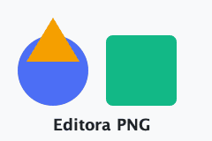

# Links

Every kind of link Editora follows. Ctrl/Cmd-click one in the source, use *Markdown: Open Link*, or
click it in the preview; *Back* returns here. Rename or move `extras.md` in the project tree to see
the links that point to it offered for updating.

## In this document

- [Jump to the last section](#reference-links) — a heading in this file.
- [Jump with a slug that has punctuation](#paths-with-spaces-and-parentheses).

## To other files

- [Another sample](extras.md) and [a heading in it](extras.md#lists).
- [A file in a folder](notes/index.md).
- [Up a level](../README.md).

## Paths with spaces and parentheses

- [Angle brackets keep a space](<notes/a note with spaces.md>).
- [Escaped space](notes/a%20note%20with%20spaces.md).
- [Parentheses in a URL](https://en.wikipedia.org/wiki/Markdown_(disambiguation)).

## Web links

- An autolink: <https://example.com/autolink>.
- A link with a title: [Editora](https://example.com "The title shows as a tooltip").
- A mail link: <mailto:someone@example.com>.

## HTML links and images

These are rewritten too when their target is renamed:
<a href="extras.md">an HTML link</a> and .

## Reference links

Read the [extras sample][extras] or the [notes index][notes]. A collapsed one: [extras][].

[extras]: extras.md "Markdown extras"
[notes]: notes/index.md
